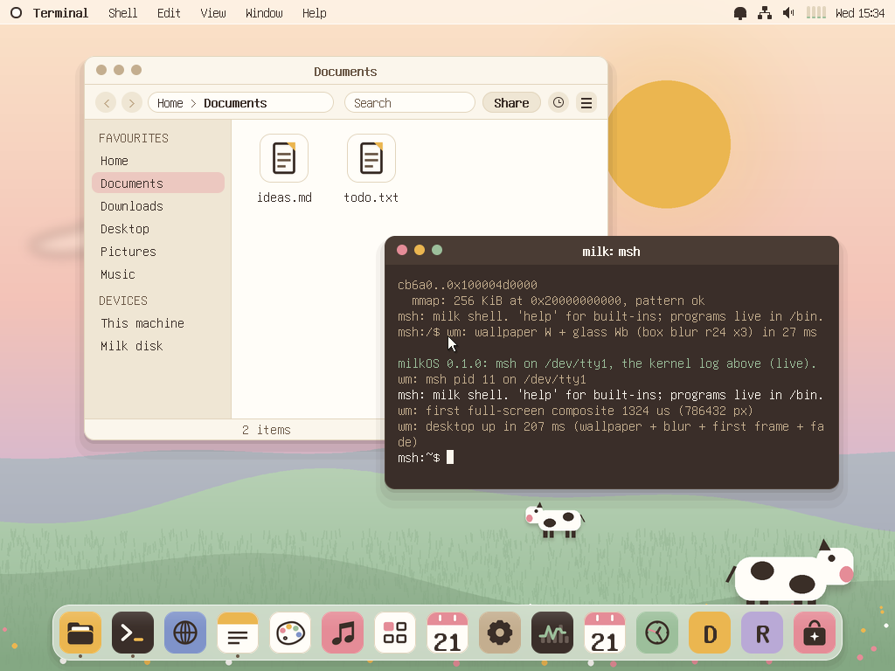

# milkOS

A hobby operating system for 64-bit ARM, written in Rust and run in qemu on a Mac. The kernel and
userland are inspired by Linux (Linux syscall numbers, `/proc`, `/sys`, a POSIX-ish shell); the desktop
is inspired by macOS (menu bar, dock, glass, Spaces, a launcher).



## Run it
```
scripts/run.sh                 # desktop window + serial console in this terminal
scripts/run.sh headless        # serial console only
MILK_SOUND=1 scripts/run.sh    # with sound through the Mac's speakers (off by default)
MILK_SHARE_RW=1 scripts/run.sh # make the Mac shared folder writable (read-only by default)
MILK_SMP=1 scripts/run.sh      # one CPU instead of four
```
Needs Rust nightly via rustup (`brew install rustup`; the toolchain is pinned in `rust-toolchain.toml`)
and `qemu-system-aarch64`. Boots with HVF acceleration on Apple Silicon.

Handy keys on the desktop: Ctrl/Cmd+Space opens Skim (the launcher), F3 opens Spaces, F4 opens Today.
The dock has Files, Terminal, Browser, Notes, Paint, Music and Settings; installed packages add their own
tiles. Ctrl+Cmd+Q locks the screen, and Ctrl+Alt+arrows snap windows to halves and quarters.

## What's in it
**Kernel**
- Boot on qemu `virt`, MMU with 4 KiB pages, frame allocator, kernel heap, GICv2, generic timer.
- SMP on 4 CPUs (PSCI bring-up, real spinlocks, IPIs, TLB shootdown), preemptive scheduler, wait queues.
- User processes at EL0 with their own address spaces, copy-on-write `fork`, threads and futexes, signals,
  job control, pipes, `chroot`. Over 80 Linux aarch64 syscalls (Linux numbering), plus a few milkOS ones.
- Capability sandbox: a process only gets the files, network and devices it is granted (`sandbox`). Apps
  installed as packages run sandboxed, and get extra files only through the Powerbox, an Open/Save panel
  drawn by milkOS itself.
- Tamper-evident audit log: every exec, connection, mount, snapshot and sandbox denial in a SHA-256 hash
  chain (`audit`, `audit verify`).

**Storage**
- VFS with tmpfs root, initramfs, devfs, procfs, sysfs.
- milkfs, our own copy-on-write filesystem: snapshots, rollback, writable clones, per-file versions,
  `snap diff`, automatic Time Machine snapshots, crash-tested (kill, power cut, torn superblock), `check --repair`.
- Your home folder lives on milkfs, so files survive reboots.
- FAT32 with long names, a page cache, and a shared folder with the Mac (`share/` here is `/Volumes/Mac` there).

**Network and sound**
- virtio-net with our own TCP/IP stack (Ethernet, ARP, IPv4, ICMP, UDP, DHCP, DNS, TCP), sockets,
  `ifconfig`, `ping`, `netstat`, `nc`, `fetch`, `httpd`. Traffic stays inside qemu's private network
  and the Mac's loopback.
- virtio-sound with a mixer, `/dev/audio`, `play`, a boot chime and system sounds.

**Desktop**
- A compositor where every window has its own buffer, glass panels, shadows, animations, dirty-rect redraws.
- Menu bar, dock, Skim launcher, Today widgets, Spaces, notifications, control centre, a light and a dark
  ("Chocolate milk") theme.
- Skim is a system-wide command bar: apps, app actions, files, settings, a calculator (`= 2+2`) and
  shell commands (`> ls`). Windows snap to edges and corners. Lock screen. Browse All Versions for any
  file on milkfs. Screenshots with Cmd+Shift+3/4 (PNG). Live resolution switching (1024x768 to 1440x900).
- Apps: Terminal (real shell, tabs, colours), Music, Files (with Time Machine), Notes, Browser, Paint, Settings,
  About. User programs can open their own windows (`user/gui`).

**Userland**
- `msh`, a shell with pipelines, redirection, job control and structured pipes:
  `ps | where rss > 100 | sort-by name`.
- Coreutils, `top`, and `milk`, a package manager with signed packages, where `milk try` installs into a
  throwaway clone of the filesystem that you then keep or discard.

## Layout
- `kernel/`: the kernel crate (`no_std`). Entry is `kernel/src/boot.S`, then `kmain` in `main.rs`.
- `user/`: user programs and the `rt` runtime library, packed into the initramfs (`initramfs.list`).
- `packages/`: toy packages for `milk` (`fortune`, `snake`, `moo2048`, `games`).
- `rootfs/`: files copied into the initramfs (`/etc`, system sounds, the web root).
- `scripts/`: run and test scripts. The main tests: `net-test.sh`, `pkg-test.sh`, `audio-test.sh`,
  `crashtest.sh`, `fattest.sh`, `wm-demo.sh <demo>`, `input-test.sh`, `screenshot.sh`.
- `docs/`: design notes, one per area: `memory`, `processes`, `smp`, `filesystem`, `networking`, `audio`,
  `packages`, `security`, `shell`, plus `AGENTS.md` (how to work on milkOS) and `ui-concepts/` (the UI spec
  and mockups). Screenshots are in `docs/screenshots/`.

## Credits
The console font is [GNU Unifont](https://unifoundry.com/unifont/) 13.0.06 (8x16 glyphs, U+0020..U+00FF),
used under the SIL Open Font License 1.1. Licence text: `assets/fonts/UNIFONT-LICENSE.txt`. The larger and
proportional UI text is drawn from the same glyphs.
