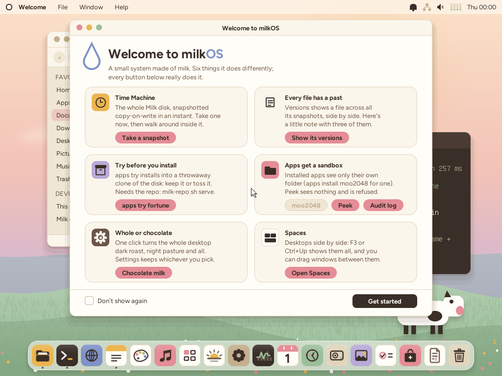
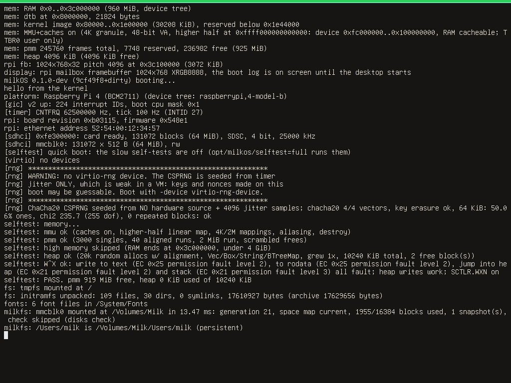
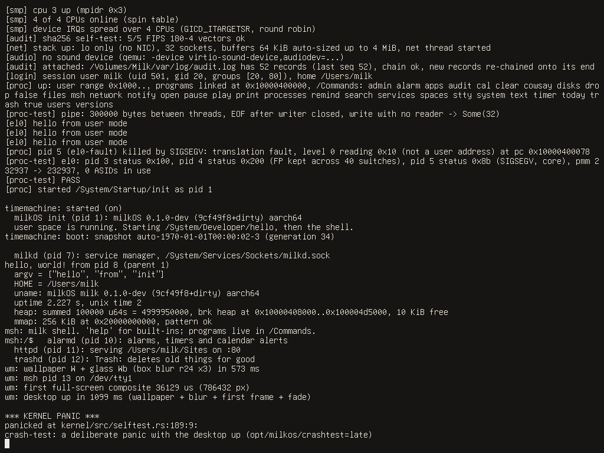
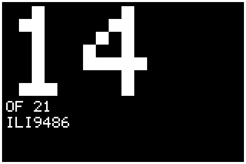
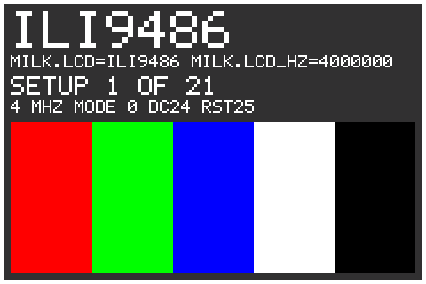
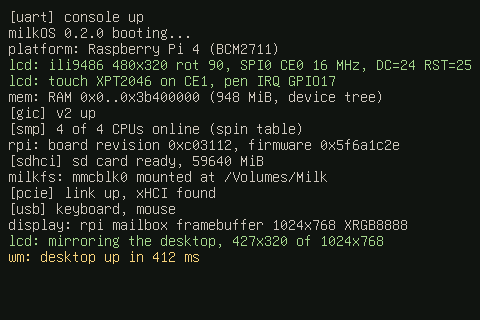
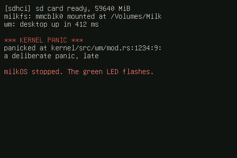
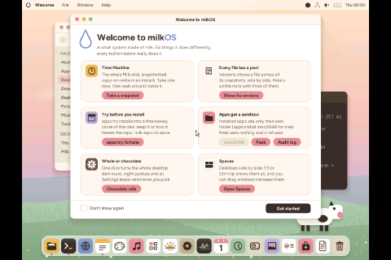
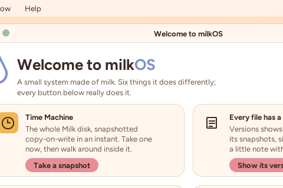

# milkOS on the Raspberry Pi 4

milkOS runs on a Raspberry Pi 4 Model B (the BCM2711: four Cortex-A72 cores, 1 to 8 GB of RAM).
The same source tree builds two kernel images: the default one for qemu `virt`, and one for the Pi
(`cargo build --features raspi`, `scripts/pi-build.sh`). This document says what exists, how to run it
under qemu's `-M raspi4b`, how to put it on a card, how it debugs itself on a board with nothing but
an HDMI screen, and, honestly, which parts have only ever run on an emulator or not at all.

Files: `kernel/src/platform.rs` (the board table), `kernel/src/el.S` (EL2 to EL1), `kernel/src/rpi/*`
(the Pi's drivers), `kernel/src/{pci,dma,timeout,crashscreen}.rs`, `kernel/src/usb/*`,
`kernel/src/net/nic.rs`, the host-tested crate `rpikit/`, `scripts/pi-*.sh`, `scripts/{usb,usb-hub,highmem}-test.sh`.



## Status

| What | State |
|---|---|
| Boot at EL2, drop to EL1, MMU on, higher-half kernel, 4 CPUs through the firmware's spin table | **runs** on qemu raspi4b (TCG); the EL2 and spin-table paths are exactly what the real firmware does |
| PL011 console, GIC-400, generic timer, scheduler, userspace, the shell, the whole desktop | **runs** on qemu raspi4b |
| Firmware mailbox, framebuffer (format, pitch and address from the firmware's answer) | **runs** on qemu raspi4b; the answer's shape is unit-tested against hostile values |
| The log on the card (`MILKLOG.TXT`, "Reading the log": everything, for the whole session, across boots) | **runs** on qemu raspi4b against generated FAT32 cards (three boots in a row on an 8 MiB file with a power cut, a crash and a clean shutdown; a 64 KiB file that wraps; a fragmented file; hostile cards that must be refused untouched; every other sector of the image is checked unchanged); the ring layout, the recovery after power cuts and the rate cap are host-tested with fuzzing; the real SD controller, real cards and timing are untested |
| Boot log and crash screen on HDMI, ACT LED codes, sign-of-life band | **runs** on qemu (screendumps are checked by the test; qemu models the GPIO block, so the test samples the LED pin: marker and codes, solid on, flashing after a crash); the LED's brightness and timing on a real board, and real HDMI scan-out, are untested |
| SD card (SDHCI, polled PIO), as `/dev/mmcblk0`, milkfs on it | **runs** on qemu (its EMMC controller); **untested** on EMMC2 of a real board |
| RAM from the device tree, several banks and holes | **runs** on qemu (two banks and a hole, the GPU's); 4 GB / 8 GB layouts are unit-tested and the allocator above 4 GiB is tested on qemu virt |
| Hardware random generator (RNG200) | **untested** (qemu does not model it); falls back to the jitter-seeded CSPRNG |
| PCIe root complex + xHCI USB (the VL805: the four USB-A sockets, which are behind a hub inside it) | the xHCI driver and the HID keyboard/mouse **run** on qemu virt (`usb-test`, hubs in `usb-hub-test`); the PCIe bring-up of the BCM2711 got as far as the VL805 on a real board and then raised an SError; reworked (steps, survivable rejections, `milk.pcie=probe`), still **unconfirmed** until the next real run |
| Ethernet (GENET + BCM54213PE PHY) | **untested**: qemu has no GENET; written from the register layout, logs every step |
| The 3.5-inch SPI display on the GPIO header and its touch chip (`milk.lcd=`) | the driver, the panel's byte streams and the touch maths are **host-tested against a model of both chips**; the whole driver **runs** on qemu raspi4b against its SPI0 controller with nothing wired to it; **untested on a real panel** (see "3.5-inch SPI display") |
| Wi-Fi (CYW43455 over SDIO), Bluetooth, the official DSI touchscreen, audio, the GPU | not started |

"Untested" means it compiles, is gated on the device tree saying the hardware exists (qemu's does not,
so those paths are skipped there) and logs what it reads; the first boot on a real board is its test.

## Running it under qemu

```
scripts/pi-run.sh               # a window (cocoa) and the serial console on this terminal
scripts/pi-run.sh headless      # serial only
scripts/pi-qemu-test.sh         # the test: twelve boots, see its header (a few minutes)
scripts/pi-log-test.sh          # the SD card log on a fragmented file and on cards that must be refused: twelve boots, see its header
scripts/pi-log-multiboot-test.sh  # the SD card log across boots: three boots on an 8 MiB file, then a 64 KiB file that wraps
scripts/pi-readlog-test.sh      # the Mac-side log reader on made-up files (no VM)
```

`-M raspi4b` runs on TCG (`-accel hvf` does not work for the Raspberry Pi machines), so boots take a
few seconds more than on `virt`. qemu 10.2.1 models: 4 Cortex-A72, the GIC-400 (GICv2) at
`0xff841000`, the ARM generic timer, PL011 UART0 (serial 0) and the mini UART (serial 1), the
mailbox with the property interface and a framebuffer, two SDHCI controllers (`0xfe300000` EMMC and
`0xfe340000` EMMC2; `-drive if=sd` lands on the first), a DWC2 USB OTG controller, GPIO, DMA, the
system timer. It does **not** model: PCIe (so no VL805, no USB ports), GENET (no Ethernet), the RNG, the
legacy `bcm2835-rng`... and its RAM is exactly 2 GiB (`-m` other than `2G` is refused: "Invalid RAM
size, should be 2 GiB"), of which the device tree it hands over shows 960 MiB (`0..0x3c000000`; the
GPU's 64 MiB, with the framebuffer at `0x3c100000`, is above that).

qemu gives the kernel **no device tree of its own**: `x0 = 0x100` points at nothing. The tests build
a small one (`scripts/pi_dtb.py`: the stock tree's shape: root `compatible` `raspberrypi,4-model-b`,
`/chosen`, `/memory`, four cpus with `enable-method = "spin-table"` and the `cpu-release-addr`s 0xd8,
0xe0, 0xe8, 0xf0) and pass it with `-dtb`; qemu then rewrites `/memory` (and removes any extra memory
nodes: it always says one bank of 960 MiB) and sets `/chosen/bootargs` from `-append`. To give the
kernel a tree qemu does not touch, `pi-qemu-test` loads it as a raw file where the boot stub's `x0`
points (`-device loader,file=...,addr=0x100,force-raw=on`; the stub's own code starts at 0x300, so the
tree must be under 512 bytes: no cpus). That is how the two-bank layout is tested.

### Boot options

The Pi has no qemu `fw_cfg`. What the tests and the launcher pass as `opt/milkos/<name>` files travels
on the kernel command line there (`/chosen/bootargs`: `cmdline.txt` on the card, `-append` under qemu):
`milk.<name>=<value>` (a value with spaces in double quotes). `fwcfg::find_file` / `read_file` serve
them, so every existing option works unchanged:

| option | does |
|---|---|
| `milk.selftest=full` (or a comma list) | the slow boot self-tests (kernel/src/selftest.rs) |
| `milk.drivers="rng=kernel sound=kernel"` | which driver runs each device (docs/drivers.md) |
| `milk.net="internet=on"` | the launcher's network policy (docs/networking.md) |
| `milk.sdwrite=1` | allow writes to the SD card (`/dev/mmcblk0` is read-only otherwise: a card that also boots Raspberry Pi OS must not be written by accident; Disk Utility, `disks` and milkfs all see it read-only) |
| `milk.disable=pcie,usb,genet,sdhci,rng` | start without a driver that misbehaves on a real board (edit `cmdline.txt`, no rebuild): `pcie` (and with it USB), `usb`, `genet`, `sdhci`, `rng` |
| `milk.genet=probe` | run the Ethernet MAC's bring-up one register access at a time, with an SError checkpoint after each, and log `[genet] probe step N name ok` (or `FAILED`): names the exact access a board refuses (see "GENET bring-up") |
| `milk.fbscale=N` | magnify the boot log and crash screen font N times (default 1; 2 from 1600 px wide) |
| `milk.ledcodes=0` | no ACT LED progress codes (the LED just turns on at the start of `kmain`; the `led: stage` log lines stay; the "log saved" signal and the log error blink are off too). Default on; the codes add about 9 s to a boot |
| `milk.lcd=ili9486` (or `ili9486p`, `ili9486p18`, `ili9488`, `st7796`, `ili9481`, `r61581`, `hx8357`, `ili9341`, `st7789`) | the 3.5-inch SPI display on the GPIO header (off without it; many more options: "3.5-inch SPI display"); `milk.lcd=probe` tries them all |
| `milk.pcie=probe` | the PCIe + VL805 bring-up in diagnostic mode: a checkpoint after every register access, a `pcie: step N name ok` line per step, and every order of the firmware handshake tried ("PCIe + USB"); `milk.disable=pcie` skips the controller (and with it USB) altogether |
| `milk.serror=trace` / `paranoid` / `off` | the SError checkpoints and the register write breadcrumbs ("Reading a crash"); `trace` is the default on the Pi image, `off` makes them no-ops, `paranoid` adds a checkpoint after every register write of the Pi drivers (slow; pins an SError to one register) |
| `milk.crashtest=serror` / `dabt` | the exception dump instead of a panic, right after the display is up: a fake SError taken at a checkpoint (qemu cannot raise a real one), or a real data abort (a store to an unmapped address) |
| `milk.logstorm=N` | once the boot is over, print N lines as fast as the console takes them: tests the SD card log's rate cap (`pi-log-multiboot-test`) |
| `milk.crashtest=early` / `late` | panic on purpose right after the display is up / once the desktop has been up 8 s (tests the crash screens); `late-off` / `late-reset`: the desktop's Shut Down / Restart after 5 s (tests the power paths) |

## Putting it on a card

The kernel is one file the firmware loads. These are **your** steps; nothing in the repository writes to
a card or a disk.

1. `scripts/pi-bootdir.sh /tmp/milkos-boot` builds the release kernel and puts `milkos8.img`,
   `config.milkos.txt`, `cmdline.milkos.txt` and the blank log file `MILKLOG.TXT` (8 MiB) in that folder (it refuses a folder on a mounted volume).
2. On the card's boot partition (the FAT one with `start4.elf`, `fixup4.dat`, `config.txt`): **keep a copy
   of `config.txt`**, copy `milkos8.img` next to the firmware's files, and make `config.txt` say
   what `config.milkos.txt` says: `arm_64bit=1`, `kernel=milkos8.img`, `hdmi_force_hotplug=1`, `max_framebuffers=1`
   and **no `dtoverlay=vc4-kms-v3d`** (milkOS draws on the firmware's framebuffer, not on a KMS display).
   Copy `MILKLOG.TXT` onto the same partition too (an ordinary copy, name in capitals; once: it keeps the log of every boot: "Reading the log").
   `cmdline.txt` can stay as it is (the kernel only looks at `milk.` words) or be replaced. The card is **read-only** to milkOS unless you add `milk.sdwrite=1` (so booting it cannot damage the other system; with the stock card there is no milkfs partition to write to anyway).
3. Put the card in a Pi 4 with an HDMI screen (or, with `milk.lcd=ili9486` in `cmdline.txt`, the 3.5-inch SPI display on the
   header: "3.5-inch SPI display"). To go back: restore the old `config.txt`. **Boot options live in `cmdline.txt`**: one line, `milk.<name>=<value>` words separated by
   spaces; to change one, put the card in any computer, edit that line (`cmdline.milkos.txt` from step 1 is a starting point), eject, boot. No rebuild.

The firmware (start4.elf) loads `milkos8.img` at 0x80000, hands over a device tree in `x0` and starts all four cores at EL2 (the
others wait in the spin table). The card also holds the root file system's persistent part: milkOS finds
milkfs volumes on any block device, so a card with a `Milk`-labelled milkfs partition mounts it as
`/Volumes/Milk` (home directories, packages, the audit log); without one the system runs from RAM
(`/` is a tmpfs filled from the image) and says "no Milk disk". Making a milkfs partition on the card
is not automated here (it needs the card's partitioning to be touched).

## What happens at boot

* `boot.S` starts at the load address, at EL2 or EL1 (`el.S`: at EL2 it sets `HCR_EL2.RW`, lets EL1 use the
  counter, copies MIDR/MPIDR, clears the trap registers and `eret`s to EL1h; at EL1 it is two instructions).
  Only core 0 runs it; it cleans and invalidates the data cache over the image, zeroes .bss, fills
  the boot tables (four 1 GiB entries chosen by the board: on virt MMIO then RAM, on the Pi RAM then
  three gaps and MMIO at `0xc0000000`: the UART must work before the real tables exist) and
  enables the MMU.
* `mem::init` reads the RAM banks from the tree (`rpikit::dtb::usable_banks`: sorted, page-aligned,
  overlaps merged, only the bank with the kernel and the ones above it). One allocator spans from the
  first bank to the end of the last; the gaps between banks (the GPU's memory, the peripheral window) are
  reserved, and only real banks are mapped, so nothing touches a gap.
* `platform::check_dtb` logs the board and warns if the tree's `compatible` is not this build's (a `virt`
  image on a Pi, or the other way round: the images are linked for different load addresses and cannot be
  mixed).
* The GIC-400 (GICv2: the same driver as qemu virt, different bases), the timer (virtual timer, PPI 11;
  if `CNTFRQ_EL0` is 0 the 54 MHz crystal is assumed), then the Pi's drivers: `rpi::init` (board info from
  the mailbox, the RNG, the SD card, the Ethernet) and so on to the shell and the desktop, as on virt.
* Secondary cores: for each `/cpus/cpu@N` the kernel reads `enable-method`; `spin-table` means
  "write the entry point at `cpu-release-addr` (clean it to the point of coherency, `sev`)" and the core
  arrives at `secondary_spin_entry` at EL2 with the MMU off and no arguments (it finds its boot block by its
  number in `spin_blocks`); `psci` means a firmware call through the conduit the tree names (qemu virt). The
  stock Pi 4 tree has no `psci` node.

## Memory map (Raspberry Pi 4, low-peripheral mode)

| Physical | What |
|---|---|
| `0x0000_0000..` | RAM. The firmware's spin table is at 0xd8..0xf8; the kernel loads at `0x80000`; the first bank ends at `0x3b400000` on a 4 GB board (the GPU's memory above it) |
| `0x4000_0000..0xfc00_0000` | more RAM (boards with more than 1 GB) |
| `0x1_0000_0000..0x2_0000_0000` | the last 4 GB of an 8 GB board |
| `0x3c10_0000` (qemu) | the framebuffer (qemu); on a board the firmware puts it in the GPU's memory |
| `0xfe10_4000` | RNG200 (hardware random generator) |
| `0xfe10_0000` | power manager (restart, power off) |
| `0xfd50_0000` | PCIe root complex |
| `0xfd58_0000` | GENET Ethernet |
| `0xfe00_b880` | VideoCore mailbox |
| `0xfe20_0000` | GPIO (ACT LED = GPIO 42) |
| `0xfe20_1000` | PL011 UART0 |
| `0xfe21_5000` | AUX: the mini UART at `0xfe21_5040` |
| `0xfe30_0000` / `0xfe34_0000` | EMMC (Wi-Fi's) / EMMC2 (the SD slot) |
| `0xfe98_0000` | DWC2 USB OTG (not a USB port on a 4B) |
| `0xff80_0000` | ARM local peripherals |
| `0xff84_1000` / `0xff84_2000` | GIC-400 distributor / CPU interface |
| `0x6_0000_0000` (CPU) = PCI `0xc000_0000` | the PCIe outbound window: BARs of the VL805 go here (1 GiB in the stock tree) |

Kernel virtual addresses are `0xffff_0000_0000_0000 + physical`, as on virt (docs/memory.md): the board's
device ranges (`0xfc000000..0x100000000`) are mapped as Device memory, each RAM bank as Normal
memory, the kernel image with W^X as before.

### RAM above 4 GB and DMA

* The device tree of a 4 GB board lists two banks (about 948 MiB, then `0x40000000` to `0xfc000000`), an
  8 GB board a third from `0x1_0000_0000` (its size cell is 32 bits, so the 4 GiB come as two entries that
  touch and merge). `mem.rs` uses all of it (`MAX_BANKS` is 8); the frame allocator, the page tables
  and the linear map take 64-bit physical addresses throughout (checked: no `as u32` on a physical
  address).
* **What can be tested where.** qemu `raspi4b` has exactly 2 GiB (the machine refuses any other `-m`), and
  rewrites the memory nodes of a tree it is given, so a real 4 GB or 8 GB layout cannot run there. What
  is tested instead: (1) host tests of the bank logic with 4 GB and 8 GB trees
  (`rpikit/src/tests.rs`: `banks_pi4_gb4`, `banks_pi4_gb8_uses_memory_above_4gib`, the hole arithmetic,
  hostile trees); (2) the two-bank layout with a hole *running* on raspi4b (`pi-qemu-test` boot 3: banks
  `0..0x3b400000` and `0x40000000..0x80000000`, the framebuffer in the hole, 1972 MiB usable); (3) memory above
  4 GiB *running*: qemu virt with `-m 6G` (`scripts/highmem-test.sh`: frames allocated above 4 GiB, written
  through the linear map and read back, freed; and `-m 8G` by hand, the RAM line says `0x40000000..0x240000000`).
* **DMA limits.** Everything on the BCM2711 that does DMA sits behind the same constraint: the PCIe
  controller's inbound window is set up to cover PCI addresses 0 to 4 GiB but the stock tree's
  `dma-ranges` give 3 GiB (`0..0xc0000000`), GENET and EMMC2 are in the "scb" domain with a `0xfc000000`
  limit, and the VL805 can address only 32 bits. So `platform::CURRENT.dma_limit` is `0xc000_0000` on the
  Pi (no limit on virt) and every DMA buffer comes from `pmm::alloc_dma_zeroed_as` / `dma::Buffer`, which
  allocate below it; the mailbox message page comes from the first GiB (the VideoCore sees RAM through a 1 GiB
  alias at `0xc0000000`). RAM above the limit is for the CPU only (user pages, the page cache, the heap).
  `memtest` checks both allocators.
* The allocator's metadata for 8 GiB is about 2.3 MiB (a bit per frame plus a tag byte), placed after the kernel.

## Debugging with nothing but an HDMI screen

There is no serial cable in this setup, so the kernel makes the screen the console:

1. **A sign of life the moment the framebuffer exists:** a green band (five rows) with a white line under it
   across the top, drawn straight into the buffer before anything else can fail. If the screen shows it, the
   firmware, the mailbox, the mapping of the framebuffer and the EL2/MMU boot all worked.
2. **The boot log** (`kprintln!`) is mirrored on the screen from that point on: first what was printed
   before the framebuffer existed (replayed from the kernel log), then everything, scrolling, in the 8x16
   console font (`milk.fbscale=2` doubles it; 1600+ wide screens do by default). No splash. The desktop
   takes the screen when it starts. The console draws in a RAM copy of the screen and writes the rows that
   changed (video memory is slow to read when it is not cacheable, and scrolling reads), once per log line.
   
3. **A crash shows its text.** A kernel panic or exception paints the end of the kernel log (which holds the
   panic message with its source line, or the exception dump: ESR, FAR, ELR, all registers) as a full-screen
   text console, then "milkOS stopped.". If the crash comes before the desktop, the boot log is still on
   screen and the dump is appended to it: the screen is not cleared. The compositor is stopped so it does not paint over it.
   
4. **The green ACT LED** is a progress readout you can count with nothing else attached: see the next section.
5. `milk.crashtest=early|late` triggers a panic on purpose so you can see the screens once.
6. **No HDMI cable at all?** The 3.5-inch SPI display on the GPIO header gets the same boot log and crash screen
   (section "3.5-inch SPI display": `milk.lcd=ili9486` in `cmdline.txt`).

## Reading a crash

Every exception (not panics: those print their message and source line) ends in a dump on the serial line, in the
log file on the card, and on the crash screen (the end of the log; the last lines of the dump are the ones that
matter most, so the dump ends with a summary). It looks like this (a data abort, then an SError taken at a checkpoint):

```
*** KERNEL EXCEPTION: synchronous exception ***
  vector 4 (current EL, SP_ELx), cpu 0, thread 0 (?)
  ESR_EL1 = 0x96000044  EC=0x25 (data abort, same EL) IL=1 ISS=0x0000044
  data abort: translation fault, level 0 on write
  DFSC=0x04 WnR=1 CM=0 S1PTW=0 EA=0 FnV=0
  FAR_EL1 = 0xfffff000dead0010  (address accessed)
  ELR_EL1 = 0xffff0000001d727c  (faulting pc)
  SPSR_EL1 = 0x800003c5  EL1h NZCV=N--- DAIF=DAIF
  SCTLR_EL1 = 0x30d8180d  ISR_EL1 = 0x80 (pending now: IRQ)  ID_AA64PFR0_EL1 = 0x2222 (RAS: none)  MPIDR = 0x80000000
  last SError checkpoint that passed on cpu 0: 'crashtest-dabt' (37 passed)
  ...

*** KERNEL EXCEPTION: SError ***
  vector 7 (current EL, SP_ELx), cpu 0, thread 0 (?)
  ESR_EL1 = 0xbe000000  EC=0x2f (SError) IL=1 ISS=0x0000000
  SError: asynchronous external abort; ELR_EL1 is where the CPU was, not the culprit
  IDS=0 IESB=0 AET=0 (uncontainable) EA=0 DFSC=0x00 (uncategorized)
  ...
  SError at checkpoint 'crashtest-serror' on cpu 0
  the access that caused it happened after checkpoint 'crashtest-before' passed and before 'crashtest-serror' (37 passed on this cpu)
  last 8 register writes on cpu 0 (oldest first):
    0xfd582000 genet+0x2000 <- 0x00000001
    ...
  summary: SError, cpu 0, thread ?, ESR 0xbe000000 (EC 0x2f SError), ELR 0x..., FAR 0x0
  where: SError AT checkpoint 'crashtest-serror', after 'crashtest-before'
  newest writes (newest first): 0xfd584018 genet+0x4018 <- 0x3; ...
*** halted ***
```

**What each line is.** `ESR_EL1` is printed in full for every synchronous exception and SError, with the exception class
name, IL and the 25-bit syndrome (decoded in `rpikit::esr`, host-tested against a table of known values and a fuzz run):
for a data abort the fault (translation / permission / access flag / external abort, with its level), read or write,
`S1PTW` (the fault was in the page-table walk), `CM` (cache maintenance), `EA` (the bus answered with an error), `FnV`
(FAR not valid) and, when the syndrome is valid, the access size and register; for an instruction abort the same;
for an SError `IDS` / `IESB` / `AET` / `EA` / `DFSC`. The Cortex-A72 of the Pi 4 has no RAS extension, so those fields
are not architected there (the dump says so; an empty syndrome is normal): the syndrome does not name the cause,
which is why the next two sections exist. `ISR_EL1` shows which interrupts are pending *at the time of the dump*
(bit 8 = an SError is pending now). On a CPU with the RAS extension (`ID_AA64PFR0_EL1.RAS` non-zero) the dump also
prints ERRIDR_EL1, DISR_EL1 and the first error records (ERXSTATUS / ERXADDR / ERXMISC0).

**An SError is asynchronous.** It is raised after the fact (a posted write to a block that is not clocked, a DMA
master that hit a bad address, a memory error) and the CPU takes it at the next moment SErrors are unmasked. The kernel
runs with SErrors masked at EL1, so before the checkpoints existed that moment was the first `eret` to EL0 on that
CPU ("vector 11, lower EL"), long after the culprit; `ELR_EL1` then says nothing about the cause.

**Checkpoints** (`serror::checkpoint(label)`, `rpi::serror_checkpoint`; `kernel/src/serror.rs`): `dsb sy`, unmask SError,
`isb`, mask again. A pending SError is taken *there*, in EL1, and the dump says `SError at checkpoint 'LABEL'` and
which checkpoint passed before it on that CPU: **the access that caused it happened between those two labels, on that
CPU.** Read the code between the two call sites and the device writes in the list below. A pending SError that is
taken outside any checkpoint says so (`SError taken outside a checkpoint`) and names the last one that passed. Labels
are `area-step`. Where they are:

| label | where |
|---|---|
| `kmain-entry` | first thing in `kmain`: an SError the firmware left pending is taken here (the dump says `before any checkpoint passed`) |
| `mem-init` `led-codes` `lcd-init` `display-init` `boot-reports` | after `mem::init`, the LED codes, the SPI panel, the display and the boot/device tree reports |
| `gic-init` `timer-init` `uart-init` | after each of them |
| `rpi-init-entry` `rpi-mailbox-info` `rpi-rng` `rpi-sdhci` `rpi-genet` `rpi-init-done` | `rpi::init`, between its steps |
| `mbox-call` | at the end of every mailbox transaction (the firmware wrote into our memory by DMA) |
| `pcie-<step>`, `pcie-order-<name>`, `pcie-bar-read`, `pcie-park`, `pcie-done`, `pcie-xhci-start`, `pcie-xhci-poll` | the PCIe + VL805 bring-up ("PCIe + USB"): one per step, one per handshake order, around the first BAR read, the park after a failure, the end, and the xHCI driver's start and polling loop. An SError taken at a `pcie-*` checkpoint (or at any checkpoint of the USB thread during the bring-up) is survived, not fatal |
| `sdhci-clock` `sdhci-card` | inside the SD driver's init |
| `genet-buffers` `genet-power-up` `genet-umac-reset` `genet-dma-off` `genet-umac-setup` `genet-rings` `genet-phy` `genet-irq` `genet-irq-on` `genet-dma-on` | the sub-steps of the Ethernet MAC's bring-up, in order (the driver catches an SError at all of them but `genet-buffers`: see "GENET bring-up") |
| `virtio-init` `crypto-init` `irq-enable` `lcd-irqs-live` `memtest` `fs-init` | the rest of the early boot |
| `sched-init-entry` `sched-init` `smp-init` `audit-journal-sysstat` | around the scheduler, SMP |
| `smp-cpu-entry` `smp-cpu-up` | on each secondary CPU as it comes up |
| `net-init` `net-tls-init` `net-up` `net-thread` | the network stack (`net-thread`: every pass of the net thread, i.e. every packet and timer) |
| `audio-init` `udrv-init-files` `proc-init` `proc-start-init` | before the first user process |
| `el0-first-run` | the start of every user thread, right before its `eret` to EL0 |
| `logfile-thread` `logfile-flush` | the boot log writer: after each flush to the card |
| `fs-threads` `lcd-start` `genet-start` `usb-start` | starting the late threads |
| `genet-poll` | the Ethernet poll thread, every 100 ms |
| `mmio-write` | only with `milk.serror=paranoid`: right after every register write of the Pi drivers |
| `tick` | the timer interrupt on **every CPU, once a second**, idle CPUs included: whatever goes wrong, it is named within a second |

**Breadcrumbs.** The MMIO accessors of the Pi drivers (GENET, SD host, SPI and GPIO, PCIe, RNG, mailbox, power manager)
record the register they wrote into a per-CPU ring of the last 8 writes; the dump prints it, oldest first, with the block
name from `rpikit::soc` (`genet+0x4018`, `emmc2+0x34`, `gpio+0x20`) and the value written, and the CPU's last register read.
The ACT LED's writes have a slot of their own (the LED code would flush everything else out of the ring). Even a crash
with no checkpoint in the right place shows the last devices that CPU touched. The interrupt controller and the UART
are not recorded (every interrupt and every character would).

**What to do with an SError dump.** (1) Find `SError at checkpoint 'B'` and `after checkpoint 'A'` (or the `where:` line at the
end). (2) Look at the writes in the list: the culprit is a device access on that CPU between A and B; the last few writes
name the block. (3) If both labels are in `genet-*`, the Ethernet bring-up is the cause; `milk.genet=probe` names the access, `milk.disable=genet` starts the board
without it. If it is `tick` after `logfile-flush`, the SD log writes. If the dump says `before any checkpoint passed`,
the firmware left it. (4) If there are several CPUs in the list of last checkpoints, the one that crashed is the one in the
vector line (`cpu N`). (5) If `trace` names a driver but not the register, boot once with `milk.serror=paranoid`: every register write of the Pi drivers is then followed by a checkpoint (`mmio-write`), the SError is taken right after the offending write and the dump says `paranoid mode: the bus error came back from the write to genet+0x...`. (6) `milk.serror=off` makes all of this a no-op (one load per call); the cost of a checkpoint is logged at
every boot (`serror: a checkpoint costs N ns`). (7) Photograph the last lines of the crash screen, or read the log file
(`scripts/pi-readlog.sh`); the LED crash code is unchanged.

## The boot log in a file

A board with no serial cable and a screen that does not light up still has an SD card that fits a Mac. The kernel writes **everything
it says** into a file on the card's FAT boot partition, **`MILKLOG.TXT`**, for the whole session and **across boots**: every boot
appends after the one before, so after a bad run you can pop the card into the Mac and read what happened, including the boot
before the one that went wrong.

### What to do, step by step (once, then after every run)

1. **Make the file, once.** `scripts/pi-bootdir.sh /tmp/milkos-boot` puts a blank `MILKLOG.TXT` (8 MiB) next to the kernel and the config
   files; `scripts/pi-logfile.sh OUTDIR [SIZE]` makes just that file (`8M` is the default; `64K` to `32M`). It is one line of text and then spaces.
2. **Copy it onto the card's boot partition** (the one with `config.txt`) with the Finder or `cp`, name in capitals, an ordinary copy.
   Do not leave the old one out and **do not copy a new blank file over it unless you want to start the log again**: the file *is*
   the log, and it keeps all the boots until it is full. The kernel never creates a file.
3. **Boot the board**, use it, let it crash, whatever you were doing. Nothing to type.
4. **Is it safe to pull the power?** Look at the green ACT LED once the boot is over (see the table below). *Two short blinks and then dark, over
   and over* = everything is on the card and the last write worked: pull the power. Solid on = still writing (wait a few seconds), or there is no log file
   on the card. A slow even blink (1 s on, 1 s off) = the card log gave up after write errors (the system is fine; the log
   stops there). After a crash the log is written before the crash cycle starts; give it ten seconds. Even if you pull the power
   at the wrong moment you lose only the last second or so of text, never the older boots. From the desktop's menu, Shut Down and Restart write the
   log and say so in it.
5. **Put the card in the Mac.** It shows up as a disk (the boot partition, often named `bootfs`). Then:

   ```
   scripts/pi-readlog.sh /Volumes/bootfs/MILKLOG.TXT --list         # one line per boot: when, how long, build, how it ended
   scripts/pi-readlog.sh /Volumes/bootfs/MILKLOG.TXT --last > last-boot.log
   ```

6. **What to send the lead**: *the whole file* is best: copy `MILKLOG.TXT` off the card (zip it; 8 MiB shrinks to a few hundred KiB),
   and say which boot was the bad one (the number from `--list`: the newest is last). If you want to send text instead, `--boot N > boot-N.log`
   for the bad boot and for the one before it. Do not edit the file.
7. **To start over**, copy a fresh blank `MILKLOG.TXT` onto the card (the old log is gone then).

`scripts/pi-readlog.sh PATH [--all | --last | --boot N | --list] [--tail N]`: the log goes to stdout, notes to stderr. `--all` (the default) prints every boot in
order, `--last` the newest, `--boot N` boot number N, `--list` a table with each boot's position in the log, line count, first and last uptime stamp,
build, and **how it ended**: `shutdown` / `restart` (a clean one through the power manager), `crash` (a panic or exception, with the crash code), or *no end line* (a
power cut, a reset, or still running when the card was taken out). `--tail N` keeps the last N lines of what would be printed. It warns when the ring has wrapped (the
oldest text was overwritten) and when sectors are damaged. Exit status 0: whole; 1: read, with a warning; 2: not a milkOS log.
The first version's 256 KiB files (format 1: one boot, an end marker) are still read, and the new kernel leaves such a file alone (it says so in the
boot log): copy that log off, then use a fresh blank file.

### On the board: `logsync`

`logsync` (a command in `/Commands`, the shell finds it) saves the log to the card **now**, the shell's own prompt line included, and prints where the log stands:

```
milklog: writing to the log file on the card
milklog: file 8388608 bytes, format 2: ring of 16382 sectors x 500 bytes
milklog: boot 7 (this one); cursor 1234567 bytes of text ever written (lap 0); 0 bytes logged but not yet on the card
milklog: 345 flushes, 6789 sectors written, 12 header writes; write errors 0 (retried), read errors 0; failed flushes in a row 0
milklog: last good flush at uptime 301204 ms (now 301380 ms); everything is saved (LED: log saved signal)
milklog: 4021 lines taken, 0 dropped by the rate cap (25 lines/s, 4096 bytes/s on average), 0 dropped because the buffer was full, 0 lost to lock contention; 3 system reports
logsync: saved
```

Exit status 0 saved, 1 not saved (no usable log file, or the card refused), 2 this machine has no SD card log. It reads and writes `/dev/milklog` (write `sync`, read the status);
at most one `sync` every two seconds does anything.

### What is in the log

Every line has an **uptime stamp** `[  123.456] ` (seconds since the board's power-on) and, for the sources below the first, a **tag**:

| source | looks like |
|---|---|
| everything printed to the console, the serial port and the screens: `kprintln!`, drivers' diagnostics (`[sdhci]`, `[pcie]`, `[usb]`, `[genet]`, `[rng]`, `spi:`, `lcd:`), `led: stage N name`, the display and probe lines, the services' and programs' output on the console, the Browser's `[browser]` lines, panics, exception dumps and the LED crash code (`led: crash code ...`) | `[   12.345] led: stage 5 sdcard` |
| the Terminal windows and pseudo-terminals: the shell and what runs in it (escape sequences removed) | `[   20.100] [tty1] msh:~$ ls` |
| the journal's lines from user space (the services' stdout and stderr, which milkd forwards) | `[    8.129] [journal alarmd/9] started as milk (pid 9)` |
| the audit log (without its hash chain) | `[    8.130] [audit] 9 pid 9 /System/Services/milkd cred setgroups...` |
| the **system report**, once when the boot has finished and every 5 minutes after | `[   10.936] [report] -- /proc/meminfo` |
| the log writer itself | `[   30.000] [milklog] the ring is full: from here...` |

What you type in a Terminal window is in the log because the terminal echoes it; a password typed with the echo off is not. Share the file the way you would share a screenshot of the Terminal.

A boot starts with a **banner**: `=== milkOS boot 7 === milkOS 0.2.0-dev (abc1234) | build abc1234 | git abc1234 | log format 2, file 8388608 bytes | uptime 4952 ms when the log was opened (counter ... at 62500000 Hz)`,
then `previous boot 6: crash` (or `shutdown`, `restart`, or `no end recorded (power cut, reset or still running)`). A clean shutdown or restart ends with `=== milkOS boot 7 ended: shutdown ===`, a crash with
`=== milkOS boot 7 ended: crash ===` after the crash dump. The text before the card is up (the first seconds of the boot) is collected in RAM and written as soon as the card and
the file are found (LED stage 5), so the log starts at the first line.

**The system report** (6 to 12 KiB each time; `[report]` lines): uptime and load; memory and memory pressure; CPU times and load; the scheduler; every thread with its CPU time; every process; the interrupt counts
per CPU; the mounts and disk counters; `/dev`; the network interfaces with their counters, the routes and neighbours, the hostname; the hardware found at boot (PCI, USB, Ethernet, SD card, board and CPU
facts); the SD controller's counters for the log writer; the SoC temperature, the firmware's throttling and under-voltage flags and the clocks (asked from the mailbox: a board whose mailbox does not
answer says so); and where the log stands.

### Caps and costs

* **Rate cap.** At most **25 lines and 4 KiB per second on average**, with room for a burst of 3000 lines / 256 KiB (a whole boot is about 350 lines, 27 KB). Lines over it are dropped and counted; the next line that gets
  through is preceded by `[milklog: N lines dropped by the rate cap (25 lines/s, 4096 bytes/s on average)]`. A crash lifts the cap. Terminal and pseudo-terminal output is looked at 8 KiB per write, lines are cut at 1000 bytes.
  A runaway loop therefore costs the card at most about 4 KiB/s (14 MB an hour) and the ring (8 MiB) lasts more than half an hour of it; an idle board writes a few hundred bytes a minute plus the report.
* **RAM.** 288 KiB for text waiting for the card (more than the largest burst the cap lets in; if it is full anyway because the card is slow, new lines are dropped and counted, so the start of the boot survives), 8 KiB of staging, 16 KiB of scratch for finding the end of the text, 6 KiB of hardware facts.
  The intake takes a spin lock for the few microseconds a line needs, never allocates and never prints, so interrupt handlers and the crash path can log; a writer that cannot get the lock within a few thousand spins drops its text (counted).
* **CPU.** The `milklog` thread has the lowest priority and wakes every 250 ms (once a second while showing the saved signal); with nothing new it does nothing. Writing needs the card for a few milliseconds a second at most.
* **SD wear.** A flush rewrites only the sector the text ended in plus the new ones: with a line a second that is about one sector a second. The header (two copies, written alternately) is rewritten
  at the start of a boot, every 64 KiB of text (a quarter of a small ring), when a boot ends and at most once a minute while there is new text. The ring spreads the writes over the whole file; 8 MiB at 1 KiB/s takes more than two hours to go round once.
* **Flush policy.** At least once a second when there is new text (sooner when 4 KiB are waiting), after each LED stage, on `shutdown`/`restart` through the power manager, on `logsync`, and in the crash path.

### The file (format 2, `rpikit::milklog`)

```
file sector 0, 1     header, two copies (written alternately; the one with the later sequence number and a good CRC wins)
file sector 2 ...    the ring: each sector = 500 bytes of text + a 12-byte trailer (absolute sector number, bytes used, boot number, CRC-32)
```

Text byte `p` of the whole log (all boots, counted from the first) lives in absolute sector `p / 500`, ring slot `(p / 500) % R`. The header is only a **hint and an index**:
magic `MILKLOG2`, version, sequence number, the geometry, the boot counter, the write cursor when it was written, and the last 28 boots (number, how it ended, start position), all under a CRC.
The kernel never trusts it blindly: at boot it starts at the header's cursor and **follows the sectors forward** (each says by itself which lap and boot it belongs to and whether it was written whole) to where the text really ends; if the header
is torn, from a different file size or lying, it scans the whole ring for the newest sector. A sector left over from the previous lap has the wrong number, a half-written one the wrong CRC, and a "ghost" behind a gap (a torn write
that landed out of order) has a boot number that goes backwards: none of them is taken for text. When the ring is full the oldest sectors are overwritten, a `[milklog]` line says where the ring went round, and the reader warns that older text is gone.
A blank file (spaces, from `pi-logfile.sh`) is upgraded in place the first time. The same procedure is in `scripts/pi_readlog.py` for the Mac.

### What it will and will not touch

The kernel reads the partition table (the first FAT32 partition, type 0x0b or 0x0c), the FAT32 boot sector, the root directory (8.3 names, case-insensitive, long-name entries skipped) and the file's cluster chain through the FAT
(fragmentation is fine, up to 128 pieces), and then **overwrites sectors of that one existing file, in place**. It never creates a file, never changes a FAT or a directory entry (not even the file's modification time or size), never
touches another partition. It refuses, and writes nothing, if: there is no MBR / FAT32 partition, no `MILKLOG.TXT` in the root, the file is under 4 KiB or over 32 MiB, the chain leaves the volume, runs through a free, bad or reserved cluster,
visits a cluster twice, has more or fewer clusters than the size needs, the volume's numbers do not add up, or the file holds an old format 1 log or something that is not a milkOS log or a blank file; each time one `milklog:` line says which. Every
sector is checked against the file's chain immediately before it is written (`rpikit::fat::LogFile::contains`). The host tests feed the parser and the recovery garbage, loops, out-of-range clusters, torn and lying headers and damaged sectors and check
that nothing panics and nothing is read or written outside the file.

**Not the block device.** The log writer has its own narrow path on the SD controller (`sdhci::raw_read` / `raw_write`): programmed I/O, polling, no allocator, no scheduler, no VFS, usable with interrupts off from the panic and exception handlers. It is not subject
to `milk.sdwrite=1`: that option protects `/dev/mmcblk0` from *ordinary* writes (so booting the card cannot damage Raspberry Pi OS's root partition); the log writer is a separate path that only `rpi/logfile.rs` calls, only for sectors it has just proved are
in the log file's clusters, and it is used even when the block device is read-only or never came up. In a crash it takes the controller (waiting 0.3 s for a transfer in progress), puts card and controller in order and flushes; a flush in progress on another CPU
gets half a second before its state is taken over. It runs from the boot CPU's low-priority `milklog` thread, from the milestones, from shutdown and `logsync`, and from the crash path.

**Errors.** A failed read or write is retried a few times (3 ms apart) at once; a flush that still fails is tried again a second later; three failed flushes in a row stop the card log for the rest of the boot: one line on the screens and
the serial port says so, the system keeps running, and the LED shows the slow even blink (1 s on, 1 s off) once the boot is over. A card with no log file, or a file we do not trust, keeps the log off and the LED solid on: one `milklog:` line in the boot log says why.

### What the LED says about the log (once the boot is over)

| LED | means |
|---|---|
| **solid on** | running; the log is still being written (or there is no log file on the card) |
| **two short blinks, then dark, once a second** | everything logged is on the card, nothing new for two seconds, **and the last write worked**: safe to pull the power |
| **slow even blink**, 1 s on, 1 s off | the card log stopped after repeated write errors; the system runs on, the log does not |
| fast flashing, then counted pulses | a crash ("After a crash") |

**What the log carries for a board you cannot see into**: `boot:` (build, the exception level the firmware entered at and the one the kernel runs at),
`cpu:` (MIDR, MPIDR, the ID_AA64 feature registers, cache lines, counter frequency, SCTLR/TCR/MAIR), `dtb:` (model, compatible strings, memory
banks, `/chosen` including `bootargs`, the CPUs, and the `compatible` / `status` / `reg` of the nodes the drivers use), `mbox:` (every step
of the mailbox probe and the firmware's answers), `[sdhci]` (base clock and where it came from, OCR/RCA, the controller registers at every failed
step), `[pcie]`, `[usb]`, `[genet]`, `[rng]`, `spi:` / `lcd:` (register values when a wait times out), and a `led: stage N name` line for each milestone.

## The mailbox on a real board (what is known, what is guessed)

On qemu the VideoCore mailbox works; on the first real board **stage 2 failed (slow 2)** while the kernel went on to stage 7. A failed stage 2 is
a *transport* failure (the firmware did not hand our buffer back in time, or there was no buffer page); a firmware that answers but refuses the
framebuffer (no monitor, `max_framebuffers=1`) is stage 3's failure, and since this change the two are separate: stage 2 is decided by a harmless
message (the firmware revision) before any framebuffer is asked for, and the log shows the answers to the other harmless tags (board model and
revision, serial, ARM and VideoCore memory split, throttling, temperature, the clocks, the firmware's idea of the display size).

Reading the driver against the BCM2835/BCM2711 documentation and Linux's use of the interface: the register offsets (read mailbox 0 at +0x00, status +0x18 bit 30
empty; write mailbox 1 at +0x20, status +0x38 bit 31 full; base `0xfe00b880`), the channel (8), the 16-byte alignment, the `0xc0000000 | phys` bus address (the
alias Linux uses on the BCM2711), the clean+invalidate before and after and the `dsb` before the doorbell all look right. The suspicions, most likely first
(none can be confirmed without a real run, the percentages are rough guesses and not measurements; **everything below is untested on hardware until the next real boot**):

1. **The reply check was stricter than the hardware needs** (fixed, untested): the old code waited for a mailbox word equal to *our* bus address with the
   channel, and gave up at the timeout otherwise. If the firmware hands the address back in another form (without the alias bits, say), every transaction would time out
   while the firmware did answer. Now the answer is accepted if it is on channel 8 and names our buffer under any alias (`rpikit::mailbox::echo`), and the buffer's
   response code (`0x80000000`) decides whether it is a good answer. Fairly plausible (~25%).
2. **The bus alias** (worked around, untested): if `0xc0000000` is not the right alias on this firmware, nothing answers. The probe now tries `0xc0000000`, `0x40000000`,
   `0x80000000` and `0x00000000` in turn (all four name the same RAM; they differ in how the VideoCore caches it) and logs which one answers. ~15%.
3. **The first answer is slow** (changed, untested): the firmware may be busy with HDMI hot-plug detection when the kernel starts (`hdmi_force_hotplug=1`, no cable). The first
   transaction now waits up to 2 s (was 1 s), the other aliases 0.5 s each. ~15%.
4. **No message page** (`NoMemory`): the page must come from below 1 GiB. Logged with the allocator's numbers if it fails. ~10%.
5. **Cache or ordering**: the code cleans and invalidates the page before and after and has a `dsb`; the only way it goes wrong is a non-coherent alias
   (suspicion 2). The log shows the buffer's first words and both status registers after a failure, which tells a stale-cache read (the request still in the buffer
   with response code 0 although the mailbox answered) from no answer at all. ~5%.
6. **Something else** (the firmware not servicing the mailbox at all, power or clock state): the log prints `mbox: registers ...`, the status registers
   before and after, any stale word waiting in mailbox 0, and the elapsed time, so the next real log decides.

If no alias answers the mailbox is marked down and later calls fail immediately instead of costing a second each. The SD controller's base clock no longer depends on
the mailbox: if the firmware cannot be asked, EMMC2 is assumed to run at 200 MHz (every Pi 4 firmware sets that; the device tree's fixed clock says the same),
logged with its source, so a dead mailbox does not also cost the board its card (before, the capabilities register's base-clock field was the fallback, which the code already calls wrong on the BCM2711, so a card could have come up at a wrong clock or not at all; that may or may not have happened on the first real boot). Untested on hardware.

## Reading the ACT LED (no screen, no serial cable)

The green ACT LED (GPIO 42) is the only output that needs nothing but the GPIO block. From the first line of
`kmain` it is on; after memory is up the kernel shows a **start marker** and then **one burst of pulses per
boot milestone**, counted by eye. Whatever the LED does *before* the start marker is the Raspberry Pi firmware's,
not milkOS's.

**What milkOS shows, in order** (pulse = 0.1 s on, 0.1 s off; after a burst the LED is dark for 0.3 s):

| you see | means |
|---|---|
| one **long** pulse (1 s on, with half a second of dark either side) | **start marker**: the firmware handed over, the kernel runs, memory is up. Everything below comes after it |
| 1 pulse | stage 1, **memory**: RAM taken from the device tree (this burst follows the marker straight away) |
| 2 pulses | stage 2, **mailbox**: the VideoCore answered |
| 3 pulses | stage 3, **framebuffer**: a framebuffer was allocated (the green band is on the screen, if one is attached) |
| 4 pulses | stage 4, **interrupts**: the interrupt controller and the timer are initialised |
| 5 pulses | stage 5, **SD card**: the card was found and read |
| 6 pulses | stage 6, **scheduler**: the scheduler runs and the other three CPUs are started |
| 7 pulses | stage 7, **userspace**: the first user process (`init`) was started |
| **solid on** | the desktop is up (or there is no framebuffer and so no desktop to wait for): **running fine** |
| then **two short blinks and dark, once a second** | running fine, and everything is saved in the log file on the card, the last write having worked ("Reading the log") |
| then a **slow even blink**, 1 s on, 1 s off | running, but the card log gave up after repeated write errors |
| **fast flashing** (10 flashes, 2 s), then dark, then groups of counted pulses, over and over | **crashed** (a panic or an exception), at any point; the groups say where: see "After a crash" below |

A good boot is: marker, 1, 2, 3, 4, 5, 6, 7 pulses (about 9 s in all), then solid on. The kernel prints
the same thing as `led: stage N name` lines in the boot log, so the log and the LED always agree.

**A milestone that went wrong repeats its number slowly**: the same N pulses, but 0.4 s on and 0.4 s off,
with 0.8 s of dark after. The boot goes on and the following stages still show (a slow code is a
report, not a stop). So a slow "3" means the framebuffer failed (the mailbox timed out, or the firmware
refused the mode) and a slow "5" means no usable SD card (none inserted, or it did not answer a bounded
wait). A slow "2" means the mailbox did not answer, so a slow "3" follows it. After the last code the LED is dark
until the next one: **if it goes dark after N pulses and stays dark, the kernel is stuck after stage N**
(inside the next step). Solid on from the very start with *no* marker means `kmain` started and then hung
before memory was up.

### After a crash: the crash cycle

A panic or an exception no longer just flashes: the LED repeats a **cycle of about 45 to 75 s (87 at most)** that says where the
kernel stopped, with nothing else attached. It is written to be counted by eye (or filmed with a phone and measured later).
The screens (HDMI and the SPI panel) are drawn first, as before; the cycle starts after them. In order:

| part | looks like | carries |
|---|---|---|
| **alarm** | 10 fast flashes, 0.1 s on / 0.1 s off (2 s), then 2.5 s dark | "it crashed". Every cycle starts with it |
| **group 1: stage** | 1 digit | the boot stage reached: 0 = before stage 1, 1 to 7 as in the table above, 8 = the desktop was up |
| **group 2: kind** | 2 digits | the exception class (ESR_EL1 EC, 6 bits), or a marker: **77 = Rust panic**, 76 = kernel stack overflow, 75 = an interrupt vector that should never be taken (or nothing recorded). Classes you may see: 45 = data abort in the kernel, 44 = data abort in a user program, 41 = instruction abort in the kernel (jumped to a bad address), 40 = in a user program, 25 = SVC, 74 = BRK, 00 = unknown reason |
| **group 3: PC** | 12 digits | the low 36 bits of the faulting address (ELR_EL1). For a panic: the **source line** of the panic |
| **group 4: FAR** | 8 digits | the low 24 bits of the address that was touched (FAR_EL1), for aborts and alignment faults (zero otherwise). For a panic: a hash of the **source file name** |

**Counting.** Every digit is **octal: 0 to 7**. A digit *d* from 1 to 7 is *d* short pulses (0.15 s on, 0.25 s dark between
pulses). **A 0 is one long pulse** (0.6 s on). After a digit the LED is dark 0.7 s; after a group (1, 2, 12 and 8 digits)
2.5 s, so groups are easy to tell apart. A whole cycle is 23 digits and takes at
most 87 s (all sevens); typically 45 to 75 s. Then it starts again with the alarm, so a missed digit costs one more lap.
The stage digit can be 8 (eight short pulses); no other digit is above 7.

**Worked example.** A data abort in the kernel (class 45), at stage 4, program counter `0xffff00000009a3c4` touching the
address `0x2000a0`: the LED shows the alarm, then

| group | digits | pulses you count |
|---|---|---|
| stage | `4` | 4 short pulses |
| kind | `4` `5` | 4 pulses, then 5 pulses |
| PC | `0 0 0 0 0 2 3 2 1 7 0 4` | five long pulses, 2, 3, 2, 1, 7 pulses, a long pulse, 4 pulses |
| FAR | `1 0 0 0 0 2 4 0` | 1 pulse, four long pulses, 2 pulses, 4 pulses, a long pulse |

The same numbers are in the log (and so on the crash screens) as one line:
`led: crash code stage=4 ec=0o45 pc=0o000002321704 far=0o10000240`, followed by `led: stage 4 ec 0x25 (data abort, same EL) pc 0xffff00000009a3c4 far 0x2000a0`.

**What to do with the numbers.** Write the digits down group by group (the long pulses are 0s) and send them to whoever builds the
kernel: `4 45 000002321704 10000240`. To read them yourself, on the Mac, in the repository:

```
python3 -I scripts/led-decode.py --elf target/pi/aarch64-unknown-none-softfloat/release/milkos-kernel 4 45 000002321704 10000240
```

It prints the stage name, the exception class in words, the full address (`0xffff000000000000` + the 12 digits: the kernel is
linked at that base plus its load address, `linker.ld`), and with `--elf` the **function and source line** at that address
(`llvm-symbolizer` or `addr2line`, whichever is installed, else `nm`). The ELF must come from the **same build** as the
`kernel8.img` on the card (`RELEASE=1 scripts/pi-build.sh` leaves it in `target/pi/aarch64-unknown-none-softfloat/release/`).
For a **panic** (kind 77) the PC group is the line and the FAR group names the file: the decoder looks the hash up in the
source tree and prints `panicked at kernel/src/foo.rs:123`. A fault in a user program (kind 40 or 44) shows the user address in
the PC group and no kernel symbol. The input may be typed as `stage=4 ec=0o45 pc=0o... far=0o...`, as the 23 digits with any
separators, or `4-45-000002321704-10000240`.

**From a phone video** (if counting live is too hard): film the LED for one whole cycle, step through the frames, and write
down when it turns on and off (frame number x 1000 / frame rate, in ms), one number per line, alternating on, off, on, off...
(`on 150` / `off 250` lines work too); then `python3 -I scripts/led-decode.py --pulses times.txt`. The rules tolerate a frame of
error at 30 fps; it finds the first complete cycle, wherever the video starts.

**If the LED does not flash at all** after a crash, the crash came before the kernel's exception vectors were set up, or the
screen code itself hung (it runs first); the log line and the stage codes you saw before it are then all there is.

**Telling it from the firmware.** Before it starts the kernel the Pi 4's bootloader uses the same LED:
a *slow* repeating group of N flashes with a long pause between groups is a bootloader error, and none of our
boot patterns look like that (ours start with the 1 s marker and are not repeated; the crash cycle starts with ten fast flashes). Three well-known ones on the Pi 4:
**4 flashes** = `start*.elf` not found or not supported (wrong firmware files for the board), **7 flashes**
= the kernel image was not found (`kernel8.img` / `kernel=` in `config.txt`), **8 flashes** = SDRAM not
recognised. For all the others see the Raspberry Pi bootloader documentation (the "LED warning flash codes").
While the firmware loads files from the card, the LED also **flickers irregularly** (SD activity); that stops
when the kernel takes over. So: irregular flicker, then the **1 s marker**, means
the firmware loaded milkOS and the kernel runs; groups of N flashes that repeat and never reach a marker mean the
firmware stopped before our kernel.

**Turning it off.** `milk.ledcodes=0` in `cmdline.txt` skips the marker and the bursts (the LED then only turns on at
`kmain`; the crash cycle is not affected). The codes busy-wait on the CPU's generic counter, so they need no
allocator, timer interrupt or scheduler; the pattern language itself is `rpikit::ledcode` (host-tested).

## 3.5-inch SPI display

A 480x320 colour TFT with a resistive touch chip that sits on the 40-pin header (the kits sold with an "LCD-show"
install script for Raspberry Pi OS). On a board with **no HDMI cable and no serial cable** it is the only debug screen,
so the boot log and the crash screen appear on it, and the desktop runs on it. It is **off unless `milk.lcd=` names its
controller**: nothing on the header is touched otherwise. Files: `kernel/src/rpi/{spi,lcd}.rs` (SPI0, the pins, the panel as
a display, the touch thread), `rpikit/src/{lcd,touch}.rs` (everything that can be decided from bytes), `rpikit/src/lcdsim.rs`
(the model of both chips the host tests run against).

**The display never holds up the boot or the boot log.** The normal bring-up (`milk.lcd=ili9486` and the other controllers) is
synchronous and early, so the log can reach the panel, but it has a hard time budget: the reset pulse, the init sequence and the first
full picture together must be done **within 1.5 s** of the start (a normal bring-up takes 0.7 to 1.1 s, about half a second of it waits the
controller needs; every single SPI transfer is also cut off at the time that is left). If not, the log says `lcd: gave up after N ms at step
init #K (command, out of time)` (or `first picture #K`), the panel stays unused and the boot goes on. The budget is `milk.lcd_budget_ms=`
(50..10000; for a kit on a very slow clock, and for the tests). After the first picture nothing in the print path waits for the panel: a
`kprintln!` sends a few rows of the log to it at most (3 ms, and only one line in 20 ms does; the others are dropped and counted, what they
changed is sent with the next send), and once the panel's own thread runs (after the scheduler) the print path sends nothing at all.
`lcd: N panel update(s) from the log were dropped so far` says that updates were dropped. `milk.lcd=probe` is not run early at all (below).

**Wiring assumed** (the usual kit; check the silkscreen, every pin is an option):

| header | GPIO | what | option |
|---|---|---|---|
| 19 / 21 / 23 | 10 / 9 / 11 | SPI0 MOSI / MISO / SCLK | fixed (ALT0) |
| 24 | 8 (CE0) | display chip select | fixed |
| 26 | 7 (CE1) | touch chip select | fixed |
| 18 | 24 | display D/C (also called RS) | `milk.lcd_dc=` |
| 22 | 25 | display reset | `milk.lcd_rst=` |
| 11 | 17 | touch pen-down line (low while touched) | `milk.touch_irq=` (`-1`: no line, poll) |
| 1 or 17 / 6 | | 3.3 V (and 5 V) / ground | |
| | none | backlight: wired on | `milk.lcd_bl=<gpio>` if the kit has a switch |

**Options** (in `cmdline.txt`, one line, space separated; `scripts/pi-bootdir.sh` writes `cmdline.milkos.txt` with
`milk.lcd=ili9486`; to change one, edit the card's `cmdline.txt` on any computer, no rebuild, and reboot):

| option | default | does |
|---|---|---|
| `milk.lcd=` | off | the controller: `ili9486` (the Waveshare-35A style kit: 16-bit words through shift registers), `ili9486p` (the same chip on plain 8-bit SPI, RGB565) and `ili9486p18` (plain, 18-bit pixels: the "35B/35C" and MPI3501 style), `ili9488` (plain, 18-bit pixels), `st7796`, `ili9481`, `r61581`, `hx8357` (plain, RGB565), `ili9341` and `st7789` (plain, RGB565, but their memory is 240x320: the picture is 320x240 landscape); `off` |
| `milk.lcd=probe` | | for a kit whose controller nobody knows: shows each candidate set-up in turn, see "Finding the controller" below |
| `milk.lcd_probe_ms=` `milk.lcd_probe_rounds=` `milk.lcd_probe_from=` `milk.lcd_probe_pins=` | 1000, 1, 1, 1 | probe mode: how long the text card stays (ms; the number card stays as long, a colour flash two fifths of it), how many times the list is shown, the set-up to start at, and `0` to leave out the pin sweeps |
| `milk.lcd_spi_mode=` | `0` | the SPI clock polarity and phase, `0`..`3` (a few kits want `3`) |
| `milk.lcd_rot=` | `90` | `0` portrait 320x480, `90` landscape 480x320 (the kit's usual use), `180`, `270` |
| `milk.lcd_bgr=` | `1` | the glass's colour order (red and blue swapped on screen: try `0`) |
| `milk.lcd_inv=` | per controller | display inversion (colours inverted: try the other value; `st7796` modules usually need `1`) |
| `milk.lcd_madctl=` | from rot/bgr | the raw memory-access byte (`0x28`...), for a glass that comes out mirrored |
| `milk.lcd_hz=` | `16000000` | SPI bit clock, up to `32000000` (divided down from the *highest* core clock the firmware reports, never faster than asked; if the firmware's mailbox does not answer, from 500 MHz, the Pi 4's default `core_freq`: a core clock that is really lower makes the bus slower, never faster; the boot log says which: `lcd: ... (core 500 MHz fallback, no firmware answer / 32, mode 0)`) |
| `milk.lcd_budget_ms=` | `1500` | the time budget of the early bring-up (50..10000 ms), see "The display never holds up the boot" above |
| `milk.lcd_dc=` `milk.lcd_rst=` `milk.lcd_bl=` `milk.touch_irq=` | 24, 25, none, 17 | pins, GPIO 2..27 |
| `milk.touch=0` | on | leave the touch chip alone |
| `milk.touch_cal=a,b,c,d,e,f` | from `lcd_rot` | calibration: `x = ((a*rx + b*ry) >> 16) + c`, `y = ((d*rx + e*ry) >> 16) + f` from the chip's raw 0..4095 readings (16.16 fixed point, offsets in pixels); `ask` runs the four-cross helper |
| `milk.lcd_view=` | `fit` | the desktop on the small screen: `fit` shows all of it scaled down (a 1024x768 desktop becomes 426x320, with bars), `pan` shows 480x320 of it 1:1 and moves the view when a finger is held within 24 px of the edge |
| `milk.hdmi=off` | auto | do not use the firmware's HDMI framebuffer: the desktop draws in RAM and the panel is the screen |

**Finding the controller (`milk.lcd=probe`).** These kits are write-only over SPI: nothing can be read back, so the kernel cannot
tell which chip is on the glass, how it is wired, or on which pins. If you do not know (or `milk.lcd=ili9486` only makes the screen
flicker blue or stay white), put `milk.lcd=probe` in `cmdline.txt` instead and boot. The kernel then goes through **22 set-ups, one after
another** (about 100 s in all; then no panel is in use; the log says `lcd: probe finished`). **It runs last**: the boot does not wait for it.
At the start of the boot the log only says `lcd: milk.lcd=probe: the probe starts after the boot is over ...` (nothing on the header is
touched); the ACT LED goes through its stage codes and the screen and the SD log come up as without a display. The probe starts on a
low-priority thread of its own when the boot is over (`led: done, solid on`, the desktop is up) and the boot log is saved to the card
(`MILKLOG.TXT`; with no log file on the card, 8 s after the boot is over); the log says `lcd: probe: the boot is over and the log is
saved ..., starting`, then the `lcd: probe n/22 ...` lines. **What you see on the ACT LED meanwhile** is what you would see without the probe:
solid on once the boot is done, then the two-blink "log saved" signal; the probe never uses the LED. Do not power off because the panel
is still busy: the log file on the card already has the whole boot. (A crash during the probe is handled as always, synchronously.)
Every set-up is reset and initialised afresh and shows, in this order:

1. **The number card** (1 s): the set-up's number, huge, white on black, with `OF 22` and the controller's name under it.
2. **Four colour flashes** (0.4 s each): the whole screen solid red, then green, blue, white.
3. **The text card** (1 s, plus the time to send it): the controller's name in big letters, the options that select the set-up (in
   capitals: type them in lower case), `SETUP n OF 22`, the clock, SPI mode and pins, then colour bars and a white border. It fills the
   whole addressed area, so whichever way the glass is mounted something shows; every set-up is landscape (rotation 90).

The number card of set-up 14 and the text card of set-up 1, drawn through the panel model (`scripts/lcd-shots.sh`):
 

**What to look for, and what to tell us.** If you see *anything* change on the screen, even only a colour flash, note **the number of
the set-up** (the number card is the best: a big white number; if you only caught flashes, count them: four flashes per set-up and a
short gap while the next is reset, about 4-5 s per set-up; the numbers below are in order) and tell us: the **number** (or the text card's words), what you saw (a number, flashes of
which colours, a readable card, half a picture, mirrored or upside-down text, wrong colours) and in which part of the cycle. A **blue
or white screen that never changes** means no set-up got through; then tell us that, and read the log (below). If a text card is readable, take
the options on it (`milk.lcd=ili9488 milk.lcd_hz=4000000 ...`) and put them in `cmdline.txt` in place of `milk.lcd=probe`. Then, from the bars or flashes: red,
green, blue in the wrong order (blue first): add `milk.lcd_bgr=0`; white looks black and black looks white: add `milk.lcd_inv=1` (or `0`
if it is set); text upside down or mirrored: `milk.lcd_rot=270` (or `180`, `0`); a clock that works at 4 MHz is raised by trying `milk.lcd_hz=` 8000000,
16000000. A 240x320 controller (`ili9341`, `st7789`) draws into 320x240, so even a normal 480x320 glass shows only a corner with it: a partial picture
is already the answer (it means the controller works, and the glass is probably the other kind).

**The set-ups, in order** (D/C GPIO 24, reset GPIO 25 unless said; every set-up has its own `milk.lcd=` name, so a person can type it):

| n | set-up | n | set-up |
|---|---|---|---|
| 1 | `st7796` 4 MHz mode 0 (the common 4-inch kits: ST7796S, 480x320) | 12 | `ili9486` 16 MHz |
| 2 | `st7796` 16 MHz | 13 | `ili9486p` 16 MHz |
| 3 | `ili9488` 4 MHz | 14 | `ili9341` 16 MHz |
| 4 | `ili9486p` 4 MHz | 15 | `ili9486` 32 MHz |
| 5 | `ili9486` 4 MHz | 16 | `ili9486` 4 MHz **mode 3** |
| 6 | `ili9486p18` 4 MHz | 17 | `ili9486p` 4 MHz mode 3 |
| 7 | `ili9481` 4 MHz | 18 | `ili9341` 4 MHz mode 3 |
| 8 | `r61581` 4 MHz | 19 | `ili9486` 4 MHz, **D/C 22 reset 27** |
| 9 | `hx8357` 4 MHz | 20 | `ili9486` 4 MHz, D/C 25 reset 24 |
| 10 | `ili9341` 4 MHz | 21 | `ili9486p` 4 MHz, D/C 22 reset 27 |
| 11 | `st7789` 4 MHz | 22 | `ili9486p` 4 MHz, D/C 25 reset 24 |

(The ST7796S of the common 4-inch kits (Waveshare 4inch RPi LCD (A) style: 480x320, plain 8-bit SPI, XPT2046 touch, D/C 24, reset 25) first, at 4 and 16 MHz, then the next likeliest chips; then the other controllers at the slow clock; the faster clocks only for the likeliest four; SPI mode 3 for three of them; the other D/C and reset pairs, as a
second round, for the two likeliest controllers. Slow set-ups at 4 MHz cannot send a full screen in 0.4 s (0.6 s for 565, 0.9 s for 18-bit), so a
colour flash covers the rows that fit, from the top, and the cards take longer to appear. `ili9341` and `st7789` use their own 320x240 area.) Why these: the
first version of the probe (ILI9486, ILI9488 and ST7796, each at 4 and 16 MHz, SPI mode 0, GPIO 24/25) already showed nothing on one real kit, so the new matrix adds the same chips with plain SPI framing (the
other common wiring), the other controllers cheap 3.5-inch kits come with, SPI mode 3, and the other pin pairs 3.5-inch Raspberry Pi kits are known to use.

**Pins the probe drives.** D/C and reset (GPIO 24 and 25, or `milk.lcd_dc` / `milk.lcd_rst`, or the pair of the set-up in the second round: 22/27, 25/24;
the previous set-up's pair goes back to inputs); SPI0 (GPIO 7-11, ALT0); the touch pen-down line `milk.touch_irq` (GPIO 17) as an input with pull-up; and, as a
backlight switch, **GPIO 18 and GPIO 27 high** (a kit whose backlight transistor hangs on one of them lights up; they are only outputs into a 3.3 V logic input).
Not 18 or 27 if a set-up uses it as D/C or reset, and not at all if `milk.lcd_bl=<gpio>` names the backlight pin (that one is driven high instead). They stay high when the probe is
over. **`milk.lcd_probe_pins=0` turns the pin sweeps off**: no backlight pins driven, and the second round (set-ups 19-22) is left out, 18 set-ups remain.
`milk.lcd_probe_from=n` starts at set-up n (to run again just the tail); `milk.lcd_probe_ms=` changes how long a card stays; `milk.lcd_probe_rounds=2` shows the list twice.

**The log.** Each set-up prints `lcd: probe n/22 NAME CLOCK MODE PINS: start (round r/R): <options>; SPI mode m divider d = k kHz of core C MHz (<where the core clock came from>); backlight high: ...`
when it starts and `lcd: probe n/22 NAME ...: done in T ms (text card B bytes in M ms = K kbit/s measured, D kbit/s from the divider)` when it ends (or `skipped after T
ms, the SPI transfers failed at the <step>`), and `lcd: probe finished in T ms: N set-up(s) shown, S skipped` at the end. The first line says whether the core clock
came from the firmware or is the 500 MHz fallback (the mailbox did not answer), and the measured kbit/s next to the divider's tells you whether the clock the bus really
got is lower (a measured rate far below the divider's: the core clock is idling at its low rate, or the CPU is the bottleneck; the picture is only slower then). With a
boot log file on the SD card, these lines are in it.

**What it shows**

1. **The boot log**, from the moment SPI0 and the panel are up (right after `mem::init`, before the display layer and
   everything memory-hungry): the log so far is replayed, then every `kprintln!` line. The text console is the kernel's own
   (8x16 font, 58 columns by 18 rows) in a static 614 KB RAM picture; because redrawing a scrolled screen would cost
   150 ms a line at 16 MHz, this console **wraps to the top and overwrites old lines** (a block cursor marks the newest
   line) instead of scrolling. Only the rows a line changed are sent (two bands of 16 rows, about 15 ms at 16 MHz), at
   once, outside the print lock and with interrupts as they are, so when the kernel stops the last line it printed is on the
   panel; the panel's thread catches up on anything the print path could not send (the bus busy, interrupts masked after
   they were switched on). Boot takes about a second longer for it.
2. **The crash screen**: a panic or exception paints the end of the kernel log on a plain scrolling console (the last 18
   lines: the panic message with its source line, or the exception dump) and "milkOS stopped. The LED flashes.". It runs
   with interrupts off and nothing allocated (a static picture, a stack buffer of 4 KB, bounded SPI waits); if another CPU
   was in the middle of a transfer the bus is taken over after 30 ms. HDMI shows its own crash screen as before.
3. **The desktop**, when the window manager starts: a view of whatever framebuffer the desktop draws on (the HDMI one,
   mirrored; or, with no HDMI framebuffer or `milk.hdmi=off`, a 1024x768 RAM one), sent in the rectangles the compositor
   reports, in the panel thread (a full frame is about 0.15 s, a mouse-sized update a few ms). **The window
   manager does not run at 480x320**: its smallest mode is 1024x768 (menu bar, dock, window minimum sizes), so the panel
   shows that picture through a view: `fit` (everything, scaled with a box filter: icons and window chrome are clear, small
   text is hard to read) or `pan` (1:1, readable, scroll by holding a finger at an edge). A real 480x320 desktop layout
   would be a window manager project of its own.
4. **Touch**: the XPT2046 on chip select 1 at 1 MHz, polled every 10 ms (when the pen-down line is low or a finger is
   already down; the chip is asked every tenth tick regardless, so a line that is not wired still works, slowly). Five
   readings of x, y and pressure per poll, rail values and light presses dropped, median of the rest. Two good polls in a
   row make a touch, three missing ones end it; taps and drags become `input::report_pointer` and left button down/up
   events, so the existing desktop works with a finger or stylus. `milk.touch_cal=ask` shows four crosses before the desktop
   starts, fits the six numbers (least squares, four touches) and shows and logs the `milk.touch_cal=...` line to put in
   `cmdline.txt` in place of `ask`.

**How the panel is driven** (written from the controllers' public datasheets and how such kits are known to behave; no third-party
code): reset pulse, `SWRESET`, `SLPOUT`, `COLMOD` (0x55: RGB565; the ILI9488 takes 0x66 over SPI: three bytes a pixel),
power, VCOM and gamma, `MADCTL` from the rotation (0x48, 0x28, 0x88, 0xe8 with BGR; the four are true rotations of each other),
display on. A window is `CASET` / `PASET` / `RAMWR` and then pixel rows, 2 KB per transfer. **The Waveshare-style kit's controller is on a 16-bit bus
that SPI feeds through shift registers**, so there every command and every parameter is a 16-bit word (high byte 0) and only
the pixel data is plain bytes: `rpikit::lcd` does that framing, the model in the tests refuses anything else.

**What is verified, and how**

* Host tests (`scripts/rpikit-test.sh`, the tests in `rpikit/src/lcdtests.rs`): the driver runs byte for byte against a model
  of the ten controllers (graphics memory, address window, MADCTL mirroring, colour format, 16-bit framing, what a viewer
  sees) and of the touch chip. They check the init streams, the window and pixel bytes, RGB565 and 18-bit packing, all four rotations
  upright on all ten controllers, partial updates sending only their rectangle, failures at every point of the bring-up,
  dirty-rectangle merging, the desktop's scaling (against a floating-point reference) and panning, the touch command bytes and
  decoding, the filter, calibration defaults, the least-squares fit, the pointer state machine, and hostile input.
  Pictures drawn through the model: 
  
   
  (`scripts/lcd-shots.sh` regenerates them; the boot log and crash text are drawn by the test with the kernel's
  font data, the desktop is the qemu screenshot above through the real scaler and panel driver).
* qemu (`scripts/pi-qemu-test.sh`, boots 8 to 12, 14 and 15): qemu's raspi4b has an SPI0 controller and nothing attached to it, so the
  *kernel's* whole driver runs: probe, pins, bring-up, the boot log, the desktop on the panel (mirrored, and as the only screen with
  `milk.hdmi=off` and `pan`), touch polling, a crash with the panel on, bad option values, an unknown controller, and the whole probe cycle (every set-up resets, initialises and draws its three signs, with the holds cut to 50 ms; its own options). It proves the
  boot never stalls or panics with a panel absent, silent or wrong; it **cannot** show a single pixel on a glass.
* **Untested until a real panel**: the init values (power, VCOM, gamma: a washed-out or dark picture is these), the MADCTL values and
  the glass's mounting (a mirrored picture: `milk.lcd_rot=`, `milk.lcd_madctl=`), the colour order and inversion, whether the clock
  is too fast for the kit's wiring (`milk.lcd_hz=8000000`), SPI0's FIFO behaviour at 16 MHz, the touch default calibration (derived from
  the kit's published numbers; `milk.touch_cal=ask` does not depend on it), the pen-down line's polarity and pull, and the desktop's
  speed on the wire.

**On the real board, in this order**: (1) the ACT LED (on while the kernel runs); (2) the panel: the boot log should appear a
second or two after power-on (a blank white or black panel with the backlight lit means it is not initialised: check the
wiring, then `milk.lcd=` for the controller (`milk.lcd=probe` tries 22 set-ups: controller, SPI mode, clock, pins), then `milk.lcd_hz=8000000`; garbled or mirrored: `milk.lcd_rot=`, `milk.lcd_madctl=`;
red and blue swapped: `milk.lcd_bgr=0`; inverted colours: `milk.lcd_inv=`); (3) touch: after the desktop appears, a finger should move
the pointer; if it lands in the wrong place or mirrored, add `milk.touch_cal=ask`, touch the crosses and copy the printed line.

**What to ask the owner**: the exact kit (a photo of the back: the controller name is often printed, "ILI9486", "ILI9488", "ST7796", and
the touch chip "XPT2046" or "ADS7846"), and whether the pin header silkscreen says GPIO 24 / 25 / 17 for D/C, reset and pen-down
(the usual) or something else.

## The drivers

**Mailbox** (`rpi/mailbox.rs`, messages in `rpikit::mailbox`): one transaction at a time under a lock, a page of
RAM in the first GiB as the buffer (`0xc0000000 | phys` as the bus address, as Linux does), cache lines cleaned
before and dropped after, status bits as in the BCM2835 datasheet (the read mailbox's bit 30 is *empty*, the
write mailbox's bit 31 is *full*). A probe (`mailbox::probe`, once, from the framebuffer's first request) sends the firmware revision through each bus alias until one answers and logs everything it sees ("The mailbox on a real board"). Used for board revision, firmware revision, the MAC address, clock rates
(the SD controller's base clock, tag `GET_CLOCK_RATE`), power domains, the framebuffer, and the VL805 reset notify.

**Framebuffer** (`rpi/fb.rs`): `SET_PHYSICAL_SIZE`, `SET_VIRTUAL_SIZE`, `SET_DEPTH 32`, `SET_PIXEL_ORDER 0`
(BGR: a little-endian `0x00RRGGBB` word is red-green-blue, what the desktop draws), alpha ignored, `ALLOCATE_BUFFER`
(16-byte alignment), `GET_PITCH`. Size, depth, address and pitch are the firmware's answer, sanity-checked
(`rpikit::mailbox::framebuffer_reply`: 32 bits per pixel, a pitch of at least a row, a buffer of at least pitch x height,
an address). A pitch that is not width x 4 is absorbed by growing the width (the rest of the kernel treats stride = width); RGB order
is refused (no screen rather than wrong colours). The buffer is in GPU memory on a board: mapped as
non-cacheable Normal memory (unaligned stores stay legal; Device memory would fault on a memcpy). Under qemu it lies
inside the RAM we manage and its frames are reserved.

**SD card** (`rpi/sdhci.rs`, encodings in `rpikit::sd`): a standard SDHCI 3.0 host with 32-bit register access only (the BCM2711's
EMMC2 needs that: 8 and 16 bit registers go through read-modify-write of the aligned word, the write-1-to-clear
interrupt status through whole-word writes). Programmed I/O, polled, every wait bounded: reset, 3.3 V, 400 kHz
identification (the divider from the clock the firmware reports), CMD0/CMD8/ACMD41/CMD2/CMD3/CMD9 (capacity from the CSD,
version 1 and 2)/CMD7/ACMD6 (4 bit), 25 MHz, `CMD17/18/24/25` with auto CMD12. Registers as `/dev/mmcblk0`; besides the block device there is the log writer's narrow path (`raw_read` / `raw_write`, "Reading the log"). The card
detect bit is not trusted on EMMC2 (the Pi does not wire it). Not yet: DMA (SDMA/ADMA2: the buffers are already below the DMA
limit), high speed mode (50 MHz), UHS, CMD23, voltage switching, SDIO. `scripts/pi-qemu-test.sh` formats an image with milkfs,
mounts it from the emulated card, writes a file, takes a snapshot, reboots and finds the file.

**RNG** (`rpi/rng.rs`): the iProc RNG200 at `0xfe104000` (control, soft resets, FIFO count/data), started and read through
bounded waits, mixed into the CSPRNG's pool at seed time like virtio-rng. If the tree has no such node it is skipped, and
the "jitter only" warning appears.

**LED** (`rpi/led.rs`, patterns in `rpikit::ledcode`): GPIO 42 as an output, on at the start of `kmain`, then the progress codes (see "Reading the ACT LED"); the crash cycle after a crash (see "After a crash").

**PCIe + USB** (`rpi/pcie.rs`, `pci.rs`, `usb/`, `rpikit::{pci,pcie,usb}`). The four USB-A sockets of a Pi 4 are behind a hub inside a VIA VL805
xHCI controller on the BCM2711's PCIe x1 link (see "USB hubs" below). Bring-up (`rpi/pcie.rs`), as a table of steps (`rpikit::pcie::STEPS`, host-tested) each of which ends
with an SError checkpoint named `pcie-<step>`:

| # | step | what |
|---|---|---|
| 1-3 | `bridge-reset`, `bridge-release`, `serdes-power` | reset the bridge, release it, SerDes out of IDDQ |
| 4 | `misc-ctrl` | 128-byte bursts, config reads of absent functions return all ones, memory access on |
| 5 | `inbound-window` | PCI 0 = CPU 0, 4 GiB (BAR2), BAR1/BAR3 off, the matching SCB size, little-endian |
| 6 | `intr-mask` | mask and clear the controller's interrupts (nothing here handles them) |
| 7-8 | `perst-release`, `link-wait` | release PERST#, wait 100 ms, wait for PHY link and data link, check root complex mode |
| 9 | `outbound-window` | from the tree's `ranges` (stock: PCI `0xc0000000` = CPU `0x6_0000_0000`, 1 GiB) |
| 10 | `root-port` | class code PCI-PCI bridge, no L0s, read the root port's id |
| 11 | `enumerate` | `pci::enumerate_deferred`: bus numbers, BARs, bridge windows; **the command registers stay off** |
| 12 | `vl805-handshake` | the firmware is told about the VL805 (`NOTIFY_XHCI_RESET`, argument `bus<<20 | dev<<15 | fn<<12` = `0x100000` for 01:00.0) with memory decoding and bus mastering still off; the chip must then answer with the same id (its BARs are put back if the reset wiped them) |
| 13 | `enable` | memory decoding and bus mastering on (bridge first), then the first read of the controller's BAR (an xHCI answers `0x01000020`-ish: version 1.00, 32 bytes of capability registers) |

Config space of the root port is the controller's register file; everything behind it goes through the index/data pair (`EXT_CFG_INDEX` 0x9000,
`EXT_CFG_DATA` 0x8000).

*What the first real board showed* (a Pi 4B rev 1.5, 8 GB, Ethernet off): the root complex came up, the link came up (status `0xb0`), the root port answered
`14e4:2711`, the VL805 enumerated (`1106:3483`, class `0c0330`, BAR0 4 KiB at PCI `0xc0000000`), and then an **SError** was taken at the mailbox
call's checkpoint, `mbox-call`, with `NOTIFY_XHCI_RESET` the newest register write. That does not prove the firmware call is the culprit: the
previous checkpoint that had passed on that CPU was the first run of a user thread, long before, and the call's checkpoint was the first
one after the whole bring-up, so **any** access of it (a config write, a window register, the call itself) could have been rejected. Hence the
checkpoint per step. The strongest suspect remains the order: the first version enabled memory decoding and bus mastering on the root port and
the device and only then asked the firmware to reset the chip, so a link bounce met a bus-mastering endpoint; a driver that enables the device
only when its own driver loads makes the call with decoding off, which is now the default order (`notify-first`).

An SError found at one of the bring-up's checkpoints (`pcie-*` labels, anything on the USB thread while the bring-up runs, the xHCI start and its
polling loop) is **survived**: `serror: absorbed an SError at checkpoint ...` with the usual attribution and the register writes is logged, the step
is reported `FAILED`, the controller is held in reset again and USB is skipped; the desktop and everything else go on. (With `milk.serror=off` there
are no checkpoints and nothing is survived.) `milk.disable=pcie` skips the controller altogether.

**`milk.pcie=probe`**: the same bring-up with a checkpoint after every register access (named by the step, so the dump's newest-writes list ends at
the register the SoC rejected), a `pcie: step N name ok` line per step, and the firmware handshake tried in **every** order of `rpikit::pcie::ORDERS`
(1 `notify-first`: call with memory decoding and bus mastering off, the default; 2 `notify-memory-on`; 3 `notify-all-on`: the first version's order;
4 `no-notify`: no call, for boards whose VL805 loads its own code), each reported as `pcie: order N name (...): ok` or `FAILED`. In the normal mode the
orders are tried in the same sequence until one works. Read the lines in order; the first `FAILED` names where the board objects.

The checks that were *not* made, as a list for the next round if this is not it: the controller's UBUS reply-error settings, the RCB/MPS mode bits of
`MISC_CTRL`, the exact window the firmware's own tree programs for DMA (`dma-ranges`: PCI `0x4_0000_0000` -> CPU 0, 8 GiB on this 8 GB board; ours is PCI 0 -> CPU 0,
4 GiB, with the DMA limit keeping buffers under 3 GiB), and a delay between the firmware call and the first access. The **xHCI driver** (`usb/xhci.rs`) is complete for what it does and runs on qemu virt's `qemu-xhci`:
reset, context base array, scratchpad, command ring, one event ring, ports (reset, speed), Enable Slot / Address Device /
Evaluate Context / Configure Endpoint, control transfers, interrupt IN endpoints, hot unplug, all polled from a thread every
4 ms, with 32- or 64-byte contexts, every wait bounded and the DMA memory synced with explicit cache maintenance (the BCM2711's PCIe
DMA is not cache-coherent). **HID boot protocol** (`usb/hid.rs`): keyboards (modifiers, six keys, rollover, software auto-repeat
after 500 ms every 33 ms) and mice (3 buttons, motion, wheel) feed `input::report_*`. `scripts/usb-test.sh` types on a `usb-kbd` and moves a
`usb-mouse` through qemu and reads `/proc/input`. Not done: interrupt-driven operation (MSI/INTx), report-protocol HID (media keys, a mouse's extra
buttons), LEDs, mass storage, isochronous.

**USB hubs** (`usb/xhci/hub.rs`, `rpikit::usbhub`). **The Pi 4's four USB-A sockets are not root ports: they sit behind a USB 2 hub inside the VL805**
(a VIA Labs hub, `2109:3431`, on root port 1). A keyboard or mouse plugged into a socket therefore has to be found through that hub; the first real run
showed `port 1: 2109:3431 class 0x9 (high speed): no keyboard or mouse interface, ignored` and nothing reached the keyboard driver. The driver now handles hubs:
a device of class 9 on a root port, or on a hub's port, gets its configuration set and its hub descriptor read (three tries); the slot
context is updated (Hub, number of ports, think time, multi-TT, with alternate setting 1 for a high speed hub of protocol 2); every port gets
SetPortFeature(PORT_POWER) and the hub is left alone for the descriptor's power-on-to-power-good time (at least 100 ms); then each port is read with
GetPortStatus every 100 ms (every 20 ms while a port is being debounced or reset; the status-change interrupt endpoint is not used, polling is simpler
and does not miss a change). What a port does is `rpikit::usbhub::PortMachine`'s decision, host-tested with a fake clock: a connection must hold for 100 ms,
the port is reset (SetPortFeature(PORT_RESET), 500 ms to finish), the speed is read from the status (low, full or high), the device is given
10 ms to recover and addressed. A device behind a hub gets its **route string** (the port number at each tier, the hub nearest the controller in the lowest
nibble), the root port, and, for a low or full speed device behind a high speed hub, the hub's slot id and the port as its **transaction translator**
(through a full speed hub that is itself behind a high speed one, the high speed hub above). A keyboard that does not answer its first descriptor request
(a slow wake-up after the port reset) gets three tries 100 ms apart; a halted control endpoint (a stall, a transaction error) is reset and its ring restarted
instead of wedging the device. A device that is unplugged is removed (keys released, slot disabled, memory freed); a hub that is unplugged takes everything
behind it with it, the furthest devices first.

Limits and what is bounded: hubs up to **3 tiers** deep (a fourth is logged and ignored), **15 ports** per hub (a route string nibble), **32 hub ports** in all,
and no more devices than the controller's slots (16 are used). SuperSpeed hubs are not driven (a SuperSpeed port of the VL805 is a separate root port; the
sockets' USB 2 side is what is used). A hub that does not answer a request is dropped at once with everything behind it, one that keeps failing after three
requests in a row; a port is tried three times (reset and enumerate), then left alone until the cable has been out for 0.5 s; more than 8 new connections
in 10 s on one port is a storm and the port is ignored for 5 s (three storms and it is given up on); an over-current port is left off and logged.
Devices that are not keyboards or mice (a flash drive, a hub's non-boot parts) are logged once and left alone, not retried. A composite keyboard's second
interface (media keys) is not driven; only the boot-protocol interface is, with SET_PROTOCOL(boot) and SET_IDLE.

The log lines (all `[usb]`, with the port named by its path: `1` is root port 1, `1.3` port 3 of the hub on root port 1, `1.3.2` port 2 of the hub
on that):

| line | meaning |
|---|---|
| `hub 2109:3431 on port 1: 4 ports (high speed, power switching per port, power good after 100 ms, over-current per port, 8 bit times think time, one translator)` | a hub was found and configured; its ports are powered |
| `port 1.3: something connected, resetting the port` | a device held its connection for 100 ms; the reset was started |
| `port 1.3: low speed device 046d:c52b, slot 4: keyboard` | the device was addressed and its HID boot interfaces started (`keyboard + mouse` for a combined one) |
| `port 1.3: hid keyboard attached (interface 0, endpoint 0x81, boot protocol)` | the keyboard interface is polled; keys now reach `/proc/input` |
| `port 1.3: device removed` / `hub removed` | unplugged (a hub's devices are removed first) |
| `port 1.3: disconnected` | something that was not driven (no slot) went away |
| `port 1.3: ... class 0x8 (full speed): no keyboard or mouse interface, ignored` | a device we do not drive |
| `hub ... port N reports no power: switching it on again` / `stays unpowered after three tries` | a hub that does not honour PORT_POWER on that port; nothing will be seen there |
| `hub ... port N reports over-current, the hub cut its power` | the port stays off |
| `port 1.3: the reset did not finish ...` / `would not enumerate in 3 tries` / `keeps connecting and disconnecting` | the port was given up on until the cable is out |
| `hub ... does not answer (Timeout): dropped, with everything on it` | the hub stopped responding; USB goes on without it |

**On the real board** the log should now show, after `[usb] xHCI 1.0: 5 ports ...`, the hub line (`hub 2109:3431 on port 1: 4 ports (high speed ...`), and for a keyboard in a
socket `port 1.N: low speed device VVVV:PPPP, slot S: keyboard` and `port 1.N: hid keyboard attached`, and the same with `mouse` (N is the port of the hub the device is in). A wireless dongle that carries both a keyboard and a mouse shows `keyboard + mouse`. If the hub line is there but no device, the hub's
power may be off (`reports no power`), the reset may fail (`the reset did not finish`), or the translator fields are not what this hub wants (the address step
then fails with a completion code: `port 1.N: low speed device: Failed(N)`; the code names the cause: 4 = transaction error, 17 = parameter error, 19 = context state). Nothing of this is confirmed on the
board yet: the host tests cover the layouts (route strings, translator fields, slot contexts, the port machine), and qemu covers a *full speed* hub (`usb-hub`) with nested hubs, hot
plug and hub removal (`scripts/usb-hub-test.sh`), not a high speed hub with a translator.

**Ethernet** (`rpi/genet.rs`, **untested**, descriptor words and autonegotiation resolution in `rpikit::genet`): UMAC reset and
setup, RGMII with the PHY adding the receive delay (`rgmii-rxid`: the PHY is left at its strapped defaults, as Linux leaves the BCM54213PE, and the MAC's transmit delay is on: `ID_MODE_DIS` clear), one 64-entry receive ring and one transmit ring (the default ring 16) of 2 KiB buffers below the DMA limit, the descriptors
in the controller's own memory, MDIO to the BCM54213PE (PHY found at the tree's address, id logged), advertise everything,
wait for autonegotiation, program speed/duplex into the MAC, interrupt on received frames (SPI 157) plus a 10 ms
poll as a safety net. It plugs into the stack as a `net::nic::Nic` next to virtio-net. Promiscuous mode is on for now.
Not done: the address filter, interrupt-driven transmit completion, checksum offload, flow control tuning, EEE, jumbo frames.

**GENET bring-up** (`rpikit::genet::init` is the step table, `rpi/genet.rs` runs it). The order, each group ending in a checkpoint
(`genet-power-up`, `genet-umac-reset`, `genet-dma-off`, `genet-umac-setup`, `genet-rings`, then after the PHY `genet-phy`, `genet-irq`,
`genet-irq-on`, `genet-dma-on`):
1. power: clear the power-down bits of `EXT_PWR_MGMT` (genet+0x80);
2. reset: write 0 to `SYS_RBUF_FLUSH_CTRL` (genet+0x08, the whole register: it can come up with its UMAC-reset bit set), pulse bit 1 of it, write 0 to `SYS_TBUF_FLUSH_CTRL`,
   then `UMAC_CMD` software reset (with local loopback, as the hardware wants), `UMAC_CMD` = 0;
3. only now the DMA engines and the UMAC: clear the enable bits of `TDMA` / `RDMA` `DMA_CTRL` (genet+0x5044 / 0x3044), pulse `UMAC_TX_FLUSH` (genet+0xb34);
4. RGMII port mode, MAC address, frame size, counters, `RBUF`/`TBUF` control, `UMAC_CMD`;
5. the descriptors and ring registers; then the PHY over MDIO; then interrupts masked and cleared, the GIC line, receive interrupts on; then the rings and the DMA engines on.

*What the first real board showed* (Pi 4B rev 1.5): the version register read fine (genet+0x00 = 0x06000000), then an SError was taken at `genet-dma-off`: the
access that the SoC refused was one of the first accesses to the UMAC / DMA registers (`genet+0x5044`, `0x3044`, `0xb34`; the earlier driver touched them
before it had released the UMAC from reset, and before the SYS block's reset register was written at all). The SoC answers a register of a block that is held in
reset or not clocked with an external abort, which arrives asynchronously. The best explanation is that the DMA / UMAC blocks were still in reset (the
`SYS_RBUF_FLUSH_CTRL` reset bit), which the new order releases first. That is a reading of the symptom, not a verified fix: nothing here could be run on the board.

*The driver now survives a refused access.* The group checkpoints are `serror::checkpoint_catch`: a pending SError is taken there and swallowed (the CPU carries on,
the board does not halt), and the driver logs `[genet] an SError was taken at checkpoint '...': the SoC refused one of the accesses of steps a..=b (of N)` with the
steps of the group, then `skipping the Ethernet controller`; the rest of the boot goes on without a network device and no SError is left pending.

*`milk.genet=probe`* (cmdline.txt) puts a checkpoint after **every** access and logs, before it, `[genet] probe step N/M name: <the access>` and after it
`[genet] probe step N name ok` (with the value for a read or a read-modify-write). A refused write ends with `probe step N name FAILED: ...` and the same skip. A refused
*read* is usually a synchronous abort instead: the crash dump is then the usual data abort, and the last `probe step N/M ...` line before it names the access. The boot log
on the card (`MILKLOG.TXT`) has all of it. qemu's raspi4b has no GENET: the option is accepted and the driver says `no Ethernet controller in the device tree` (`pi-qemu-test`).
`milk.disable=genet` skips the driver without touching the controller at all.

*What to look for in the next real log.* (1) `probe step ... ok` all the way to `genet-dma-on`, then `[genet] PHY at MDIO address 1, id 0x600d84a2` and a `link up` line: the
reset order was the fix. (2) `probe step N name FAILED`: that register is refused whatever the order; the line before it says which and in what state (the read of `ext-pwr-read`
shows the power register, the `umac-reset-*` steps the reset bit); the likely next suspects are the clock/power domain of the block (firmware: the GENET clock is not
in the tree the firmware hands over, so it should be on) and the order of the first access. (3) Everything ok but `no PHY answered on MDIO`: the MAC is fine, the
problem is the MDIO clock / PHY reset. (4) Link up but no frames: RGMII delays (`ID_MODE_DIS`), the descriptors.

## What qemu can and cannot test (summary)

| Can | Cannot |
|---|---|
| EL2 entry, the EL1 drop, spin-table SMP, the GIC-400, the timer | the real firmware's quirks (cache state at entry, GIC security configuration, `CNTFRQ_EL0`) |
| the mailbox, the framebuffer, the console font, the crash screens | HDMI scan-out, the LED, the real VideoCore's answers |
| SDHCI against qemu's controller, milkfs on it | EMMC2's quirks, a real card's timing, high speed |
| device tree parsing, banks and holes, 64-bit physical addresses (on virt) | a 4 GB / 8 GB board's actual tree |
| xHCI, HID, hubs (a full speed `usb-hub`, nested, hot plugged), PCI enumeration (on virt) | the BCM2711 PCIe bring-up, the VL805 and its high speed hub's translator, USB 3 |
| the net stack (on virt) | GENET, the PHY, the RGMII timing |
| the SPI display's driver against qemu's SPI0 controller (nothing attached), its byte streams against a host model | whether a glass shows anything; the touch chip |

## Known gaps

* No Wi-Fi (the CYW43455 needs an SDIO driver and its firmware blob: `brcmfmac43455-sdio.bin` and the `.txt` NVRAM
  from the Pi OS image, which must not be committed here: load them from the card at run time), no Bluetooth, no
  official DSI touchscreen (the 7" panel is I2C plus the DSI display through the firmware; the 3.5-inch SPI kit has a driver, see its section), no audio (the `bcm2835` PWM/I2S
  or HDMI audio), no GPU acceleration (the VideoCore needs a mailbox/firmware protocol milkOS does not speak).
* The desktop at 1024x768 on a Pi's CPU has not been measured; if it is slow the options are the release build (the default
  for `pi-bootdir.sh`) and a smaller compositor workload.
* No power button support (the Pi 4 has none; a GPIO button is a few lines on top of `rpi/power.rs`). The desktop's Shut Down and
  Restart use the SoC's power manager (`rpi/power.rs`: a watchdog full reset, with the firmware's halt marker set first for "off", so the board
  stays down until power is cycled); both are tested on qemu (`pi-qemu-test` boots 6 and 7).
* The SPI display (section "3.5-inch SPI display"): polled PIO only, no DMA (a full frame costs the CPU about as long as the wire: ~0.15 s
  at 16 MHz, so the desktop on the panel moves at a few frames a second when much changes); the pen-down line is read as a level every
  10 ms, not taken as a GIC interrupt; no backlight dimming (it is wired on, or `milk.lcd_bl=` switches it on); the panel cannot be
  read back, so a wrong controller or wiring shows as a wrong picture and not as an error; the desktop is not laid out for 480x320
  (see there); if the window manager falls back to the text console (out of memory) the panel keeps showing the desktop's last picture.
* Thermal throttling is not watched (mailbox `GET_TEMPERATURE` exists).

## Stage 2: what to do with a board, in order

1. **Boot with the screen only.** Build with `scripts/pi-bootdir.sh`, copy, power on. Expected: the green band within a second
   (the firmware has to load a 30 MB file first), then the boot log scrolling, then the splash-less desktop. If the band appears
   and the log stops, the crash screen or the last line says where; the LED flashes after a crash. If nothing appears at all:
   check the LED (the 1 s start marker = the kernel ran; see "Reading the ACT LED"), `config.txt` (arm_64bit, kernel name, no KMS overlay), the card's other files.
2. **SD card.** Look for `[sdhci] 0xfe340000: card ready`. If EMMC2 does not answer, the log says at which command; the base clock
   is logged by the mailbox (`clock_rate`). A card without a milkfs partition: the desktop runs from RAM.
3. **USB.** Look for the `[pcie]` lines (link up status word), `[pci]` (the VL805: vendor 1106, device 3483, class 0c0330), `[pcie] ... BAR0 reads 0x0100....`
   (the first read of the controller), `[usb] xHCI`, then `hub 2109:3431 on port 1: 4 ports` (the sockets are behind the VL805's hub), then `port 1.N: ...: keyboard` / `mouse` ("PCIe and USB", USB hubs). If a `pcie: step N ... FAILED` or `serror: absorbed` line
   appears, the register writes under it name the access the SoC rejected. Not clear? Put `milk.pcie=probe` in `cmdline.txt`: the next log has a line per step
   and the result of every order of the firmware handshake. If the link is down the first suspects are the PERST# timing, the SerDes IDDQ bit and the window
   registers (all in `rpi/pcie.rs`); if the VL805 enumerates but the xHCI does not start, the `NOTIFY_XHCI_RESET` call and the DMA window are next.
4. **Ethernet.** `[genet]` lines: the version register, the PHY id (BCM54213PE answers `0x600d84a?`), link up with speed and duplex,
   then `[net] dhcp`. If the PHY answers but no frames arrive: RGMII delays (`ID_MODE_DIS`; the PHY's skew straps), the descriptor ring
   registers, promiscuous mode.
5. **Then** the interrupt-driven USB and the SD DMA, the address filter, performance work, and Wi-Fi.

What needs the owner: a **serial cable is not needed** for the order above (the screen carries the log), but if any step fails in
a way the screen cannot show (a crash before the framebuffer exists), a USB serial adapter on GPIO 14/15 with `enable_uart=1` (the
config file above already has it) gives the same log at 115200 8N1 from the very first line, and a photo of the screen when the
LED flashes is the next best thing.

## How the untested drivers were checked

qemu cannot run them, so their register layouts were checked against the public behaviour of the Linux drivers and headers (read as
reference, nothing copied: `pcie-brcmstb.c`, `bcmgenet.{c,h}`, `unimac.h`, `bcmmii.c`, `broadcom.c`, `raspberrypi-firmware.h`) and against
the device tree of a real board's boot partition (a read-only copy, not in the repository: `MILK_REAL_DTB=... scripts/pi-qemu-test.sh`
boots it under qemu and the host tests parse it). That caught, among others: the RNG200's address (`0xfe104000`, not where memory put it),
the PCIe outbound window (1 GiB at CPU `0x6_0000_0000`, PCI `0xc000_0000`, not 64 MiB), the DMA burst length (`0x10`), the PHY needing no skew
setup, and the SDHCI `broken-cd` flag. What this cannot catch: timing, electrical, and anything the register documentation leaves out.
